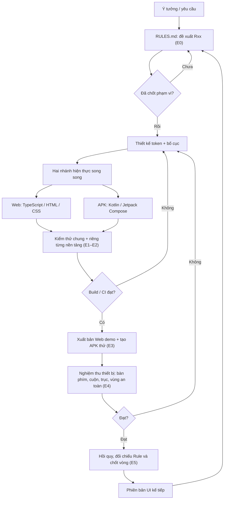

# 2027 — RULES.md

> **Nguồn quy tắc duy nhất (Single Source of Truth)**  
> Repo: `1sl2tp/2027` · Trạng thái: **R01 — đã khởi tạo** · Ngày: **18/11/2026 (giờ Việt Nam)**  
> Phạm vi: Web App/PWA (TypeScript + HTML + CSS) và Android APK native (Kotlin + Jetpack Compose).

## RULE 01 — MỘT FILE RULE DUY NHẤT

### 1. Mục tiêu
Toàn bộ các quyết định kiến trúc, UX/UI, CSS/design tokens, Android Compose, chất lượng, bảo mật, quy trình kiểm thử và phát hành của `2027` được quản lý **trong duy nhất file `/RULES.md`**.

### 2. Điều bắt buộc
1. **Chỉ `/RULES.md` được đặt ra quy tắc chuẩn tắc.** Không tạo `AGENTS.md`, `RULES-v2.md`, `STYLE_RULES.md`, `docs/*rules*` hoặc bản quy tắc song song có khả năng xung đột.
2. README, source code, tài liệu kỹ thuật và workflow CI **có thể trích dẫn hoặc triển khai** quy tắc này, nhưng **không tự bổ sung quy tắc khác**. Nếu thấy bất đồng, sửa `RULES.md` trước rồi đồng bộ code/test trong cùng thay đổi.
3. Mỗi thay đổi quy tắc phải ghi **mã phiên bản Rxx, mục đích, lý do, ảnh hưởng Web/APK, trường hợp kiểm thử, bằng chứng và cách hoàn tác** ngay trong file này.
4. Không gộp **đề xuất** với **đã triển khai**. Mỗi quyết định phải có trạng thái: `Đề xuất` → `Chấp nhận` → `Đang làm` → `Đã kiểm thử` → `Đã phát hành` → `Đã nghiệm thu thực tế`.
5. **Một hệ thiết kế, hai renderer:** Web dùng TypeScript/HTML/CSS; Android dùng Kotlin/Jetpack Compose. Không dùng WebView để giả làm APK native. Tỷ lệ, thứ bậc, token và hành vi phải đối chiếu được, nhưng tôn trọng API native từng hệ.
6. Mọi thay đổi phải **không làm gián đoạn dữ liệu thật**, không lấy token, khóa API, tin nhắn, đơn hàng, thông tin khách hàng hoặc CSDL production từ dự án khác. Chưa cấu hình backend thì UI chỉ là khung, không được giả vờ gửi/thu thành công.
7. **Không mặc định deploy production**, sửa DB production, gửi thông báo/tin nhắn hay giao dịch thật. Phát hành demo và xây APK thử là những bước riêng, cần có kết quả build và kiểm tra thực tế.

### 3. Cách kiểm soát mỗi vòng
Định danh: `2027-R01`, `2027-R02`, ... (quy tắc) và `2027-UI-V01`, `2027-UI-V02`, ... (vòng thiết kế). **Rxx không phải số phiên bản ứng dụng đã phát hành.**

Các chứng cứ:
- **E0** — yêu cầu, quy tắc và phạm vi được ghi rõ.
- **E1** — code và kiểm thử tĩnh đã có.
- **E2** — kiểm thử tự động/build cục bộ đạt.
- **E3** — CI, bản build hoặc deploy demo có xác nhận thành công.
- **E4** — mở và thao tác trên Web/PWA và APK thiết bị thật; ghi bằng chứng từng nền tảng.
- **E5** — nghiệm thu, hồi quy và xác nhận không có tác động ngoài phạm vi.

Không ghi `PASS` cho E2–E5 khi chưa có bằng chứng. Link GitHub source không đồng nghĩa demo đã xuất bản.

### 4. Sơ đồ tiến trình thống nhất



### 5. Sơ đồ cấu trúc dự kiến (chưa khẳng định đã tạo)
```text
2027/
├── RULES.md             ← tài liệu quy tắc duy nhất (đã tạo ở R01)
├── web/                 ← TypeScript + HTML + CSS (dự kiến)
├── android/             ← Kotlin + Jetpack Compose (dự kiến)
└── .github/workflows/   ← kiểm thử và build (dự kiến)
```

### 6. Tiêu chí hoàn thành RULE 01
- [x] Tồn tại một file `RULES.md` tại gốc repo.
- [x] Định nghĩa rõ một nguồn quy tắc, phạm vi Web/APK, cách đặt phiên bản và chuẩn E0–E5.
- [x] Sơ đồ luồng công việc được ghi trực tiếp trong `RULES.md`.
- [ ] Có kiểm tra tự động bảo đảm không thêm file quy tắc thứ hai (thuộc vòng triển khai tiếp theo).
- [ ] Có Web demo và APK chạy được (thuộc các vòng triển khai tiếp theo).

### 7. Nhật ký thay đổi

| Mã | Ngày VN | Nội dung | Trạng thái |
|---|---|---|---|
| 2027-R01 | 18/11/2026 | Khởi tạo một nguồn rule duy nhất, quy ước Web/APK, vòng sửa, E0–E5 và sơ đồ tiến trình | E0, chờ xác minh GitHub commit |

### 8. Rollback
Nếu R01 cần sửa, **không tạo file quy tắc thay thế**. Chỉnh cùng `RULES.md`, tăng mã Rxx và ghi nguyên nhân. Nếu phải hoàn tác, dùng lịch sử commit GitHub, giữ đúng một rule owner.
