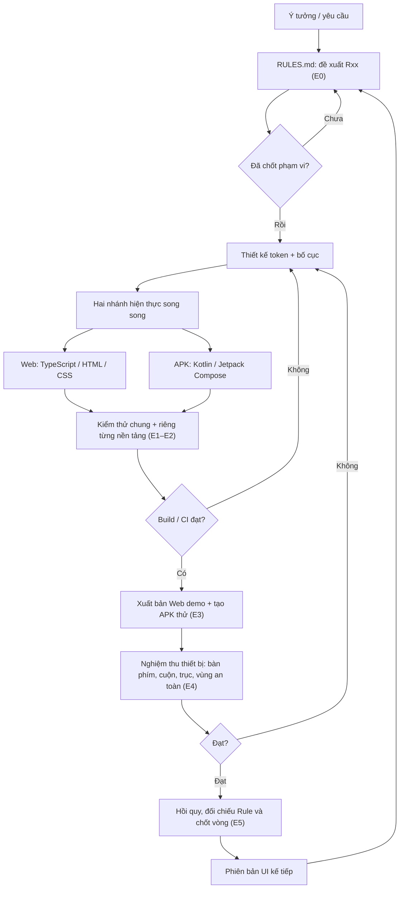
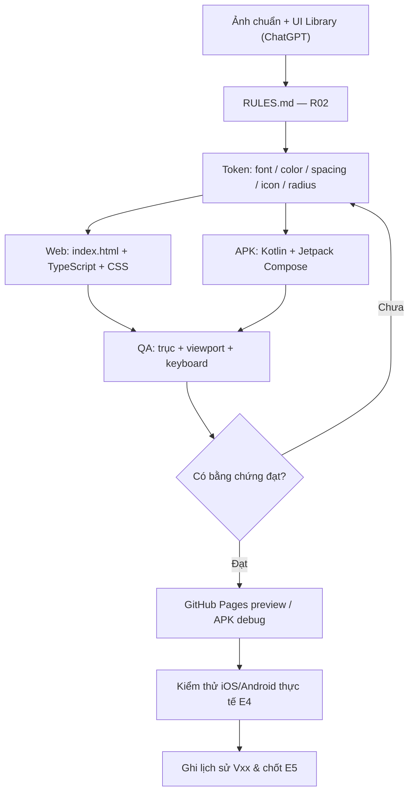

# 2027 — RULES.md

> **Nguồn quy tắc duy nhất (Single Source of Truth)**  
> Repo: `1sl2tp/2027` · Trạng thái: **R09 / UI-V17 — thư viện UI/UX** · Cập nhật: **22/11/2026 (giờ Việt Nam)**  
> Phạm vi: Web App/PWA (TypeScript + HTML + CSS) và Android APK native (Kotlin + Jetpack Compose).

## RULE 01 — MỘT FILE RULE DUY NHẤT

### 1. Mục tiêu
Toàn bộ các quyết định kiến trúc, UX/UI, CSS/design tokens, Android Compose, chất lượng, bảo mật, quy trình kiểm thử và phát hành của `2027` được quản lý **trong duy nhất file `/RULES.md`**.

### 2. Điều bắt buộc
1. **Chỉ `/RULES.md` được đặt ra quy tắc chuẩn tắc.** Không tạo `AGENTS.md`, `RULES-v2.md`, `STYLE_RULES.md`, `docs/*rules*` hoặc bản quy tắc song song có khả năng xung đột.
2. README, source code, tài liệu kỹ thuật và workflow CI **có thể trích dẫn hoặc triển khai** quy tắc này, nhưng **không tự bổ sung quy tắc khác**. Nếu thấy bất đồng, sửa `RULES.md` trước rồi đồng bộ code/test trong cùng thay đổi.
3. Mỗi thay đổi quy tắc phải ghi **mã phiên bản Rxx, mục đích, lý do, ảnh hưởng Web/APK, trường hợp kiểm thử, bằng chứng và cách hoàn tác** ngay trong file này.
4. Không gộp **đề xuất** với **đã triển khai**. Mỗi quyết định phải có trạng thái: `Đề xuất` → `Chấp nhận` → `Đang làm` → `Đã kiểm thử` → `Đã phát hành` → `Đã nghiệm thu thực tế`.
5. **Một hệ thiết kế, hai renderer:** Web dùng TypeScript/HTML/CSS; Android dùng Kotlin/Jetpack Compose. Không dùng WebView để giả làm APK native. Tỷ lệ, thứ bậc, token và hành vi phải đối chiếu được, nhưng tôn trọng API native từng hệ.
6. Mọi thay đổi phải **không làm gián đoạn dữ liệu thật**, không lấy token, khóa API, tin nhắn, đơn hàng, thông tin khách hàng hoặc CSDL production từ dự án khác. Chưa cấu hình backend thì UI chỉ là khung, không được giả vờ gửi/thu thành công.
7. **Không mặc định deploy production**, sửa DB production, gửi thông báo/tin nhắn hay giao dịch thật. Phát hành demo và xây APK thử là những bước riêng, cần có kết quả build và kiểm tra thực tế.

### 3. Cách kiểm soát mỗi vòng
Định danh: `2027-R01`, `2027-R02`, ... (quy tắc) và `2027-UI-V01`, `2027-UI-V02`, ... (vòng thiết kế). **Rxx không phải số phiên bản ứng dụng đã phát hành.**

Các chứng cứ:
- **E0** — yêu cầu, quy tắc và phạm vi được ghi rõ.
- **E1** — code và kiểm thử tĩnh đã có.
- **E2** — kiểm thử tự động/build cục bộ đạt.
- **E3** — CI, bản build hoặc deploy demo có xác nhận thành công.
- **E4** — mở và thao tác trên Web/PWA và APK thiết bị thật; ghi bằng chứng từng nền tảng.
- **E5** — nghiệm thu, hồi quy và xác nhận không có tác động ngoài phạm vi.

Không ghi `PASS` cho E2–E5 khi chưa có bằng chứng. Link GitHub source không đồng nghĩa demo đã xuất bản.

### 4. Sơ đồ tiến trình thống nhất



### 5. Sơ đồ cấu trúc dự kiến (chưa khẳng định đã tạo)
```text
2027/
├── RULES.md             ← tài liệu quy tắc duy nhất (đã tạo ở R01)
├── web/                 ← TypeScript + HTML + CSS (dự kiến)
├── android/             ← Kotlin + Jetpack Compose (dự kiến)
└── .github/workflows/   ← kiểm thử và build (dự kiến)
```

### 6. Tiêu chí hoàn thành RULE 01
- [x] Tồn tại một file `RULES.md` tại gốc repo.
- [x] Định nghĩa rõ một nguồn quy tắc, phạm vi Web/APK, cách đặt phiên bản và chuẩn E0–E5.
- [x] Sơ đồ luồng công việc được ghi trực tiếp trong `RULES.md`.
- [ ] Có kiểm tra tự động bảo đảm không thêm file quy tắc thứ hai (thuộc vòng triển khai tiếp theo).
- [ ] Có Web demo và APK chạy được (thuộc các vòng triển khai tiếp theo).

### 7. Nhật ký thay đổi

| Mã | Ngày VN | Nội dung | Trạng thái |
|---|---|---|---|
| 2027-R01 | 18/11/2026 | Khởi tạo một nguồn rule duy nhất, quy ước Web/APK, vòng sửa, E0–E5 và sơ đồ tiến trình | Đã có commit, E0–E1 |

### 8. Rollback
Nếu R01 cần sửa, **không tạo file quy tắc thay thế**. Chỉnh cùng `RULES.md`, tăng mã Rxx và ghi nguyên nhân. Nếu phải hoàn tác, dùng lịch sử commit GitHub, giữ đúng một rule owner.

---

## RULE 02 — CHAT DESIGN SYSTEM V01 (Web + Android native)

**Mã**: `2027-R02` · **Phiên bản khung**: `2027-UI-V01` · **Ngày VN**: 18/11/2026  
**Trạng thái**: E0 (đặc tả) + E1 (khung source) được tạo; E2/E3/E4/E5 chỉ ghi đạt khi có bằng chứng build/CI, bản xem thử và kiểm thử thiết bị tương ứng.

### 2.1. Nguyên tắc sản phẩm
- Đích tham khảo là **mức độ hoàn thiện thị giác và hành vi của ChatGPT**: chữ, font, màu, lề, khoảng cách, độ bo, icon, kích thước điều khiển, scroll và composer. Yêu cầu "giống 100%" được diễn giải thành **mục tiêu so sánh pixel từng vùng với ảnh tham chiếu đã chốt**, không được khẳng định "100%" khi chưa có đo thực tế, và không sao chép logo/tên/nhãn thương mại hoặc giả danh ChatGPT.
- Học **ChatGPT (phân cấp nội dung, composer, vùng đọc)**, **WhatsApp (điều hướng hội thoại, media)**, **Telegram (phản hồi nhanh, điều hướng)**, **Signal (tối giản, trạng thái riêng tư)**, **iMessage (native touch/keyboard)**. Các hãng khác là *tham khảo quy luật*, không tự động hợp nhất những hành vi mâu thuẫn.
- Giữ nhận diện tên app **2027**. Không hiển thị giả tin nhắn/khách hàng/đơn hàng; khi chưa kết nối phải ghi rõ trạng thái, không tạo nút gửi thành công giả.
- **Một thiết kế, hai triển khai**: Web = TypeScript/HTML/CSS; APK = Kotlin/Jetpack Compose. Token semantic dùng chung; Compose dùng dp/sp và thích nghi mật độ thiết bị, không nhúng HTML/CSS trong APK.

### 2.2. Token thị giác cơ sở, áp dụng cho cả 2 nền tảng

| Token | Light | Dark | Dùng cho |
|---|---|---|---|
| `bg` | `#FFFFFF` | `#161616` | Mặt nền hội thoại |
| `sidebar` | `#F9F9F9` | `#171717` | Sidebar / drawer |
| `surface` | `#F7F7F8` | `#292929` | Thẻ nền nhẹ |
| `soft` | `#F1F1F1` | `#2E2E2E` | Tab được chọn |
| `ink` | `#171717` | `#F3F3F3` | Chữ chính |
| `muted` | `#656565` | `#B2B2B2` | Chữ phụ |
| `line` | đen ~9.5% alpha | trắng ~11% alpha | Viền mảnh |
| `focus` | `#3A83F7` | `#3A83F7` | Focus rõ ràng |

- Font Web: `-apple-system-body, ui-sans-serif, -apple-system, BlinkMacSystemFont, Segoe UI, Arial, sans-serif`. Font APK: `FontFamily.SansSerif` tôn trọng Android font rendering. Không đóng gói font độc quyền hoặc nạp font từ CDN.
- Typography: input/nội dung chính **16px/24px** (Compose 16sp/24sp); header title **18/26**; tên tab **13–14/20**; chú thích **12–14/20–22**; version **10–11px**; primary weight 600–650, secondary 400–500.
- Nhịp spacing một nguồn: **4, 8, 12, 16, 20, 24, 32px** (Compose dp tương ứng). Không dùng margin tùy tiện làm lệch 2 cạnh.
- Icon nét giản lược khoảng **20px, stroke 1.8**, nhưng vùng tương tác độc lập **44 × 44px/dp**; icon không được nhỏ/lệch vì padding của button. Label dài không che icon.
- Radius: composer **28px/dp**, tabs tròn capsule, panel **12–18px**. Border mặc định 1px/1dp, shadow rất nhẹ hoặc không có.
- Header cao **56px/dp**; sidebar desktop **260px**; cột đọc/chứa composer tối đa **720px**; composer tối thiểu **56px/dp**; ô nhập tự giãn tối đa **160px**, sau đó cuộn bên trong.
- Các giá trị này là **baseline theo bản chụp tham chiếu lưu trên Drive**, không phải tuyên bố thông số ChatGPT hiện hành bất biến.

### 2.3. Trục bố cục, từ ngoài vào trong
- **M1 / Shell**: chiếm đúng phần màn hình có thể nhìn; không cuộn cả body; Web đo `window.visualViewport` (height + offsetTop) khi bàn phím mở.
- **M2 / Header**: chiều cao cố định 56; menu trái, tab trung tâm, tìm kiếm/chế độ nhìn phải. Các nút căn tâm thị giác và có hit target 44.
- **M3 / Nội dung hội thoại**: phần **flex:1, min-height:0**, tự cuộn một owner; cột nội dung 720 tối đa, căn giữa desktop; mobile dùng full width với gutter 12–18. Không đẩy composer xuống dưới màn hình khi keyboard hiện.
- **M4 / Composer**: đứng cuối vùng khả dụng và ở trên keyboard/safe-area; layout theo trục nút – text – mic – gửi. Khi text 1–6 dòng, ô nhập mở theo nội dung; sau đó scroll nội bộ. Không rung giật khi xuống dòng, dấu câu hoặc bàn phím gợi ý thay đổi.
- **P1–P4 / Popup**: overlay phải nằm trong visual viewport; focus không bị cắt; input/tác vụ đóng và danh sách kết quả được tiếp cận trên iOS Safari, Chrome Android, Web/PWA và APK native.
- **Responsiveness**: desktop sidebar hiện thường trực; màn hình <=760px sidebar thành drawer; <=350px điều chỉnh khoảng trống nhưng không để nội dung gây tràn ngang. Nút và glyph vẫn cân xứng.
- **Tính năng tối thiểu**: mở/đóng menu, chọn Trò chuyện/Công việc, tìm kiếm trạng thái rỗng, sáng/tối (Web) hoặc theo hệ điều hành (Android), nhập nháp, bật nút gửi khi có nội dung. Chưa nối backend → click gửi báo chưa tích hợp và giữ bản nháp.

### 2.4. Reference và phương pháp nghiệm thu
Nguồn ảnh/số đo được phép đối chiếu:
- UI Library đã cung cấp: `https://drive.google.com/drive/folders/1-lafp9tLlQC7uRAX3jSyhvb9kmWj_Jgq`; snapshot thư viện cho biết spacing 4px, nhóm font hệ thống, header 52–56px, composer bo 28px/min-height 56px, trục nội dung khoảng 720px.
- Ảnh tham chiếu iPhone/Web có thể khác phiên bản thực tế; cần chốt hình và kích cỡ viewport trước khi đánh giá sai số.

**Nghiệm thu bắt buộc**: 
1. So hai cột cạnh/cùng trục: header, văn bản, ô nhập, nút, nội dung, khoảng trống, khi 320/360/375/390/414/430px và desktop 1024/1440px.
2. Đo keyboard đóng/mở trên iPhone Safari/PWA, Android Chrome/PWA và APK Compose: phần thấy được, nút gửi không khuất, last row chạm được, không double scroll, không focus zoom iOS.
3. Thử 1/3/6/10 dòng, landscape, safe area, dark theme, reduced motion, menu/drawer, Back, accessibility focus, font scale lớn.
4. Kiểm tra tính nhất quán sau mỗi vòng bằng ảnh chụp, đo hình học, log và build; ghi E0–E5 riêng Web/APK.
5. Cần dữ liệu thật/API ở các vòng sau phải qua xác thực, phân quyền và test read-only trước; không dùng data production để lấp khung.

### 2.5. Sơ đồ xây khung



### 2.6. Hạng mục code V01
- `index.html`, `web/styles.css`, `web/src/app.ts`: shell Web, tab, drawer, composer co giãn, popup tìm kiếm, theme và no-send guard.
- `android/app/src/main/java/app/twentytwentyseven/chat/MainActivity.kt`: shell native cùng cấu trúc, có imePadding/navigationBarsPadding, draft nhập được, gửi chỉ báo trạng thái.
- `tests/layout.test.mjs`: hợp đồng cấu trúc Web/native và một file RULES duy nhất.
- `.github/workflows/pages.yml`: dự định build/kiểm thử và phát hành Pages khi repo đã bật chế độ Pages dùng Actions.
- `.github/workflows/android.yml`: dự định assembleDebug và cung cấp APK debug qua workflow artifacts. Chưa coi APK tồn tại cho đến khi build SUCCESS.

**Nhật ký R02**
| Mã | Nội dung | Trạng thái |
|---|---|---|
| 2027-R02 / 2027-UI-V01 | Tạo khung Chat Web và khung Kotlin Compose, bộ token chung, keyboard-first, trạng thái rỗng không dữ liệu giả | E0 + E1; E2–E5 chờ bằng chứng |

**Hoàn tác**: revert commit R02, khôi phục toàn bộ Web/native/workflow cùng một lần. Giữ nguyên R01, không tạo file quy tắc thứ hai.

---

### 2.7. UI-V02 — Căn lại khung từ ảnh so sánh Web/iPhone (18/11/2026)

**Tình trạng**: đã tạo source và bổ sung kiểm thử cấu trúc; CI/Pages/thiết bị thật phải được xác nhận riêng.

- **Hình học**: header mobile phân 3 trục trái–giữa–phải; tab được giữ ở giữa, một hành động cạnh phải. Tìm kiếm và theme chuyển vào drawer trên màn hình hẹp; trên desktop các chức năng vẫn nằm ở header.
- **Nội dung rỗng**: không đặt tiêu đề và icon quảng bá chiếm vùng đọc; giữ đúng một dòng trạng thái nhỏ ở cuối vùng hội thoại. Không giả dữ liệu.
- **Composer hai tầng**: hàng 1 là textarea 16px/24px với auto-grow 36–144px; hàng 2 có nút thêm bên trái, mic và gửi bên phải. Control 44px (<=350px điều chỉnh 40px với phương án kiểm thử truy cập riêng); không dùng vị trí tuyệt đối gây chồng hàng.
- **Keyboard/Popup**: composer nằm cuối visual viewport, popup tìm kiếm bám đỉnh phần màn hình nhìn thấy; vẫn yêu cầu kiểm thử iOS Safari/Chrome PWA và Android thật.
- **Đánh giá so khớp**: ảnh từ thiết bị và trình duyệt chỉ dùng để xác định khác biệt. Không kết luận giống ChatGPT 100% khi chưa đo cùng viewport, font scaling, keyboard và độ phân giải.
- **Phạm vi**: V02 điều chỉnh Web; APK Compose vẫn ở V01 và được đánh dấu *chưa đồng bộ V02*, tránh tuyên bố sai.
- **Trở lui**: revert thay đổi V02 ở `index.html`, `web/styles.css`, `web/src/app.ts`, `tests/layout.test.mjs` và đoạn 2.7 tại đây; không ảnh hưởng dữ liệu/backend.

| Phiên bản | Thay đổi | Bằng chứng |
|---|---|---|
| `2027-UI-V02` | Header ba trục, empty state tối giản, composer hai tầng, popup đúng visual viewport | E0/E1; E2–E5 cần xác minh |

### 2.8. CI Android — sửa môi trường build sau V02 (18/11/2026)

Lần chạy GitHub Actions của nhánh APK thất bại ở `android-actions/setup-android@v3`, vì `sdkmanager tools` trả lỗi `Failed to find package 'tools'` trước khi Gradle được chạy. Chỉ thay thế bước chuẩn bị SDK bằng công cụ có sẵn trên runner và cài đúng `platforms;android-35`, `build-tools;35.0.0`; không sửa mã nghiệp vụ hay token. Chỉ đánh dấu APK debug có khi `assembleDebug` và upload artifact thành công. Rollback: hoàn tác riêng bước setup Android nếu có lỗi runner tương thích mới.


---

## RULE 03 — NGUYÊN TẮC UX/UI CHO THƯ VIỆN MẪU 2027

**Mã:** `2027-R03` · **Ngày:** 22/11/2026 (giờ Việt Nam) · **Trạng thái:** Áp dụng cho thiết kế mẫu; việc đáp ứng từng tiêu chí ở Web/PWA/Android phải được kiểm tra riêng.

### 3.1. Phạm vi và cách sử dụng

- `2027` là **kho thư viện mẫu UI/UX**. Giai đoạn hiện tại ưu tiên các mẫu font, cỡ chữ, kiểu chữ, màu nền, thành phần và cấu trúc khung; **không phải** ứng dụng CHAT đã kết nối dữ liệu. Các đặc tả chat trong R02 là tham chiếu lịch sử, không ép mọi mẫu UI phải giống chat.
- Các ý tưởng của chuyên gia dưới đây là **nguyên tắc thiết kế**, không phải bộ kích thước pixel cố định hoặc lời chứng thực của họ dành cho dự án. Mỗi quy tắc có ví dụ áp dụng riêng cho 2027 và tiêu chí quan sát được.
- Khi có mâu thuẫn, ưu tiên theo thứ tự: **an toàn/khả năng tiếp cận → hoàn thành tác vụ → nội dung dễ đọc → bố cục và nhất quán → trang trí**. Không tối giản bằng cách che thao tác cần thiết; không tăng chi tiết chỉ để lấp chỗ trống.
- Chỉ cập nhật rule ở `RULES.md`; không tạo file rule song song. Việc sửa rule không tự động cấp phép sửa CHAT production, dữ liệu, gửi thông báo hoặc phát hành APK.

### 3.2. Nguồn tư tưởng đã đối chiếu

| Tác giả/nguồn | Ý chính có thể tham khảo | Nguồn gốc |
|---|---|---|
| **Jakob Nielsen** | 10 usability heuristics: trạng thái hệ thống, phù hợp ngôn ngữ thực tế, kiểm soát, nhất quán, ngăn lỗi, nhận biết thay vì nhớ, tối giản | [Nielsen Norman Group — 10 Usability Heuristics](https://www.nngroup.com/articles/ten-usability-heuristics/) |
| **Don Norman** | Discoverability, signifiers, phản hồi, mô hình tư duy, quan hệ tự nhiên giữa điều khiển và kết quả | [Don Norman — Opportunities and Challenges for Touch](https://jnd.org/opportunities-and-challenges-for-touch-and-gesture-based-systems/) · [Design of Everyday Things](https://jnd.org/preface-design-of-everyday-things-revised-edition/) |
| **Steve Krug** | `Don't Make Me Think`: điều hướng dễ hiểu, giảm các câu hỏi không cần thiết cho người dùng | [Tác giả và sách](https://sensible.com/dont-make-me-think/) |
| **Luke Wroblewski** | Mobile first: giới hạn màn hình buộc ưu tiên tính năng, nội dung và thao tác quan trọng | [Mobile First — Constraints](https://www.lukew.com/mobilefirst/04-chapter-2/index.html) |
| **Brad Frost** | Atomic Design: atoms, molecules, organisms, templates, pages; nhìn thành phần và toàn thể cùng lúc, **không phải** quy trình tuyến tính bắt buộc | [Atomic Design — Methodology](https://atomicdesign.bradfrost.com/chapter-2/) |
| **Chuẩn bổ trợ, không phải tác giả nói trên** | WCAG 2.2: tương phản, mục tiêu tương tác; Apple HIG: vùng chạm và chữ có khả năng thích ứng | [W3C WCAG 2.2](https://www.w3.org/TR/WCAG22/) · [Apple HIG Accessibility](https://developer.apple.com/design/human-interface-guidelines/accessibility) |

### 3.3. Các quy tắc thực hành, độc lập với phong cách thị giác

| Mã | Quy tắc ứng dụng trong 2027 | Cách kiểm tra trong thư viện | Cơ sở |
|---|---|---|---|
| **UX-01 — Mục tiêu rõ** | Mỗi trang/mẫu phải có mục đích chính, một thứ bậc tiêu đề rõ, hành động chính dễ tìm; thành phần phụ không cạnh tranh sự chú ý. | Nhìn vào mẫu thấy nội dung ưu tiên và thao tác chính mà không cần đọc hướng dẫn dài. | Krug; Nielsen |
| **UX-02 — Trạng thái hiển thị** | Tùy chọn font, palette, cỡ chữ, nút, tab phải phân biệt trạng thái đang chọn/không chọn; thao tác có phản hồi thật, không báo thành công giả. | Đổi một lựa chọn, cả điều khiển và preview cập nhật đồng bộ; screen reader nhận `aria-pressed` hoặc trạng thái phù hợp. | Nielsen; Norman |
| **UX-03 — Ý nghĩa trước biểu tượng** | Label hành động dùng từ ngữ người dùng hiểu; icon chỉ bổ trợ. Signifier (dấu hiệu trực quan) phải gợi đúng nơi và cách tương tác. | Không cần đoán nút chỉ có biểu tượng lạ; thao tác và kết quả thống nhất. | Norman; Krug |
| **UX-04 — Nhất quán toàn thư viện** | Cùng chức năng dùng cùng tên, trục căn, token và hành vi ở các mẫu; không tạo nhiều kiểu nút trông giống nhau nhưng có tác dụng khác. | Đặt hai mẫu cạnh nhau, cùng loại thành phần có cùng vai trò và quy tắc. | Nielsen; Frost |
| **UX-05 — Tránh lỗi, có lối quay lại** | Hành động không hợp lệ được ngăn từ đầu; thay đổi thử nghiệm có thể `Đặt lại` hoặc hoàn tác. Thao tác nguy hiểm phải có biện pháp bảo vệ phù hợp. | Thử nhập/sửa/đặt lại; dữ liệu trong preview không bị mất ngoài dự kiến. | Nielsen |
| **UX-06 — Nhận biết thay vì ghi nhớ** | Các lựa chọn quan trọng, tên nhóm và lựa chọn hiện tại nhìn thấy được; menu phụ chỉ chứa chức năng ít dùng. | Chuyển nhóm mẫu rồi quay lại vẫn biết đang chọn gì, không phải nhớ bước trước. | Nielsen |
| **UX-07 — Tối giản có chủ đích** | Chỉ giữ thành phần cần cho mục đích của mẫu; khoảng trắng tạo nhóm và nhịp đọc, không tạo vùng rỗng hoặc thanh điều hướng vô ích. | Xóa một thành phần: nếu không giảm khả năng hiểu/thao tác thì có thể bỏ; nếu giảm thì giữ. | Krug; Nielsen |
| **UX-08 — Mobile first thật** | Thiết kế ở màn hình hẹp và trạng thái bàn phím mở trước, rồi mới mở rộng ra tablet/desktop; hành động thiết yếu luôn tiếp cận được. | So sánh 320/360/390/430px; bật bàn phím, thử ô nhập dài, safe area, xoay ngang; không che nút chính. | Wroblewski + yêu cầu riêng 2027 |
| **UX-09 — Thành phần có cấp** | Phân biệt token/atom (màu, font, nút), molecule (ô tìm + nút), organism (header/composer), template (khung), page (mẫu với nội dung). Thiết kế và kiểm tra hai chiều: phần ↔ toàn thể. | Sửa token trong một nguồn, các mẫu liên quan thay đổi nhất quán; không nhân bản bản vá CSS cho mỗi trang. | Frost |
| **UX-10 — Chữ là hệ thống phân cấp** | Tiêu đề, nội dung, nhãn phụ khác nhau có chủ đích về cỡ, đậm, dòng và khoảng cách; hỗ trợ dấu tiếng Việt, xuống dòng và phóng to chữ. Không dùng chữ nhỏ làm giải pháp duy nhất để nhét đủ nội dung. | Thử 4 họ font của V03, độ đậm 400–700, cỡ chữ 13–21px; ở mọi cỡ mẫu phải không chồng/tràn/cắt chữ. | Krug; Apple typography + lựa chọn dự án |
| **UX-11 — Tương phản đo được** | Với chữ thông thường, mục tiêu **WCAG 2.2 AA ≥ 4.5:1**; với chữ lớn đủ điều kiện, **≥ 3:1**. Không dùng màu sắc làm tín hiệu duy nhất. Palette chỉ là phương án thử đến khi đo và xác nhận độ tương phản cho đúng cặp chữ/nền. | Đo từng cặp chữ–nền của white/warm/mist/dark; đánh dấu `chưa đạt` nếu chưa đo, không ghi WCAG PASS theo cảm giác. | W3C WCAG 2.2 |
| **UX-12 — Vùng chạm và thao tác** | Với mẫu iPhone/iPad, ưu tiên vùng chạm **ít nhất 44×44 pt** theo Apple HIG. Với web, WCAG 2.2 AA dùng ngưỡng **24×24 CSS px hoặc ngoại lệ theo tiêu chí 2.5.8**; đây là hai hệ đo/khuyến nghị khác nhau, không được coi tương đương. Các nút chính trên mobile của dự án ưu tiên hit area khoảng **44 CSS px** khi có đủ diện tích. | Kiểm tra hit box thực tế, khoảng cách các đích, focus bàn phím và khả năng thao tác bằng một tay; icon nhỏ vẫn có vùng chạm đủ lớn. | Apple HIG; W3C WCAG 2.2 + lựa chọn dự án |
| **UX-13 — Không chồng quyền quản lý vùng** | Shell, Top 1, Top 2, Nội dung, vùng thao tác và overlay phải rõ cha–con; một vùng cuộn chính cho một bề mặt. Top 2 có thể ẩn khi không cần, composer giữ trong vùng nhìn thấy khi bàn phím mở. | Thử nội dung ngắn/dài, mobile/desktop, bàn phím đóng/mở; không double scroll, rung gõ hoặc nội dung bị che. | Áp dụng riêng 2027 từ mobile-first và discoverability |
| **UX-14 — Mẫu thật về hành vi, trung thực về dữ liệu** | UI Library dùng dữ liệu minh họa/khung trung tính; không giả trạng thái đã gửi, đã lưu máy chủ hay đã thu tiền. Bộ chọn, reset, preview, copy CSS phải hoạt động được hoặc được ghi rõ chưa hỗ trợ. | Từng nút có kết quả đúng nhãn; không network đến backend CHAT/TAPHOA và không dùng dữ liệu khách thật. | Nielsen + giới hạn bảo vệ của dự án |

### 3.4. Quy trình áp dụng khi tạo một mẫu mới

1. **Xác định tác vụ**: người dùng cần xem gì, làm gì, trên thiết bị nào; không bắt đầu bằng màu trước khi biết cấu trúc.
2. **Dựng khung cha–con**: Shell → Top 1/Top 2 → Nội dung → Thao tác/overlay; xác định vùng được phép co, cuộn, ẩn.
3. **Chọn token**: font, các cấp cỡ chữ, spacing, palette, radius; ưu tiên dùng biến có sẵn, không nhân bản.
4. **Tạo trạng thái đối chiếu**: bình thường/đang chọn/focus/disabled; sáng/tối; mobile/rộng; bàn phím đóng/mở nếu có input.
5. **Kiểm tra bằng chứng**: tương phản, nhãn, vùng chạm, keyboard, overflow, focus, khả năng quay lại; lưu phiên bản mẫu để so sánh trước/sau.
6. **Mới tinh chỉnh thẩm mỹ**: chỉnh lề, nhịp chữ, viền, độ bo, độ sâu, màu. Không tuyên bố giống 100% một ứng dụng khác khi chưa đo cùng viewport.

### 3.5. Bài kiểm tra đầu tiên — trang Chữ & màu nền V03

- Chọn một trong 4 palette → chỉ vùng preview đổi màu; toàn bộ nhãn và điều khiển thư viện vẫn nhận diện rõ.
- Chọn System UI/Arial/Georgia/Mono → tiếng Việt còn dấu đúng, không vỡ chữ; thử nội dung dài.
- Thay cỡ 13–21px, giãn dòng 1.20–1.90 và đậm 400/500/600/700 → thay đổi hiện ngay, không tràn khung mobile.
- Bản rộng và mobile có cùng nội dung/ý nghĩa; không ép chữ nhỏ vì màn hình hẹp.
- `Đặt lại` khôi phục lựa chọn mặc định; `Sao chép CSS` sao chép đúng token hiện hành hoặc báo rõ nếu không được cấp quyền.
- **Chưa xác nhận** WCAG/thiết bị thật nếu chưa đo; kiểm thử tĩnh/CI không thay cho E4/E5.

### 3.6. Thứ tự ưu tiên, lịch sử và hoàn tác

| Mã | Nội dung | Trạng thái |
|---|---|---|
| **2027-R03** | Tổng hợp Nielsen, Norman, Krug, Wroblewski, Frost; cụ thể hóa thành UX-01 đến UX-14 cho kho UI | Đã ghi đặc tả; chỉ ghi E2/E3 sau khi CI thực tế đạt; chưa nghiệm thu thiết bị E4/E5 |

**Ảnh hưởng:** Chỉ tài liệu chuẩn tắc của repo `2027` và kiểm thử hợp đồng tương ứng. Không thay giao diện CHAT production, không sửa backend, không thay Android APK. **Hoàn tác:** revert commit tài liệu R03; không tạo file quy tắc mới.

---

## RULE 04 — ĐỐI CHIẾU CÁC HỆ UI LỚN, NHƯNG GIỮ MỘT HỆ CSS RIÊNG

**Mã:** 2027-R04 · **Ngày:** 22/11/2026 (VN) · **Trạng thái:** Đã ghi đặc tả, chưa áp lại giao diện hoặc nghiệm thu thiết bị thật.

### 4.1. Mục đích và cơ sở

Dùng các bản lưu nguồn **ChatGPT, Facebook, Gemini** do người dùng đặt trong [thư mục UI 2027](https://drive.google.com/drive/folders/1uPNFbeA_lbJjIEZW0O__g4lTWWXJEVSj?hl=vi) làm đối chứng khi chọn thành phần UI. Bảng đối chiếu có bằng chứng CSS và giới hạn nguồn tại [`references/CHATGPT_FACEBOOK_GEMINI_UI_COMPARISON_2026-11-22.md`](./references/CHATGPT_FACEBOOK_GEMINI_UI_COMPARISON_2026-11-22.md).

- **ChatGPT:** lấy nguyên tắc typography, cột nội dung, Markdown, input/composer gọn, các trạng thái icon.
- **Facebook:** lấy nguyên tắc danh sách, sidebar, nhãn trạng thái, mật độ hàng, icon + chữ + vùng bên phải, bubble và input (chỉ từ component có bằng chứng).
- **Gemini:** lấy nguyên tắc nhịp spacing, bố cục co giãn, input đa chế độ, trạng thái viền/surface và menu.
- **2027:** chỉ dùng **một `web/styles.css`** và bộ token riêng; không tạo các theme/hệ CSS cạnh tranh theo hãng, không copy nguyên stylesheet/class build/asset proprietary.

### 4.2. Quy tắc bắt buộc

| Mã | Quy tắc | Điều kiện kiểm tra |
|---|---|---|
| UI-REF-01 | Phân biệt **nguồn HTML/CSS đã lưu**, **quan sát từ ảnh** và **quyết định thiết kế 2027**. | Mỗi con số ghi đúng nguồn và giới hạn snapshot; không khẳng định là CSS ChatGPT/Facebook/Gemini hiện tại khi chưa kiểm chứng. |
| UI-REF-02 | Mỗi thông số phải có **vai trò** trước khi có CSS; dùng token `font/color/spacing/radius/border/focus/hit-area` chung. | Thành phần bảng, nút, input số lượng, search, chat, menu và popup không sở hữu CSS nền tảng thứ hai. |
| UI-REF-03 | Nhìn **cấu trúc cha–con và trạng thái tương tác** trước khi tinh chỉnh màu hoặc bo góc. | So sánh desktop/mobile, input được focus, bàn phím mở, nội dung 1–4 dòng, số tiền, menu/popover. |
| UI-REF-04 | Không mang nội dung tài khoản, tên người, dữ liệu nhạy cảm, font file, hình thương hiệu hoặc đoạn CSS minified của bản Save Page vào repo demo. | Source Google Drive giữ nguyên, commit chỉ chứa mô tả, số liệu, các phần code do dự án tạo. |
| UI-REF-05 | Tách **giá trị xác nhận trong CSS** khỏi **lựa chọn áp dụng**. | Không áp/đổi CSS hoặc tự gắn trạng thái hoàn tất kiểm thử thiết bị chỉ dựa vào một ảnh hay biến CSS. |

### 4.3. Tác động, kiểm thử và hoàn tác

**Tác động Web/APK:** vòng R04 chỉ ghi tài liệu cho kho Web UI 2027, chưa áp cho `web/styles.css`/APK hoặc dự án CHAT/TAPHOA. Khi triển khai component trong các vòng sau, dùng các nguyên tắc UX-09–UX-14 và kiểm thử tương phản, focus, hit area, cuộn/chồng bàn phím, dark/mobile.

**Bằng chứng:** tài liệu đối chiếu trích các giá trị trong ba tệp HTML Save Page, liệt kê giới hạn trang Facebook Reel, preset ChatGPT Codex và các CSS theme/viewport Gemini; kiểm thử hợp đồng bảo đảm R04 và tài liệu không bị rơi khỏi repo. **Chưa có:** E4/E5 nghiệm thu trên thiết bị thực.

**Hoàn tác:** revert commit R04 (tài liệu + kiểm thử hợp đồng), không có schema/backend/CSS/app data cần đảo ngược.

---

## RULE 05 — GIỮ MỐC GỐC VÀ TÁI SỬ DỤNG MỘT MẪU NỀN TẢNG

**Mã:** 2027-R05 · **Ngày:** 22/11/2026 (VN) · **Trạng thái:** Đã ghi và có triển khai mẫu V09; chỉ đánh dấu đã kiểm thử/phát hành sau khi CI xác nhận, chưa nghiệm thu thiết bị thật.

### 5.1. Mục đích và lý do

Giữ nguyên bản thư viện hiện có trước khi tạo mẫu mới, đồng thời xây **một mẫu gốc 2027** độc lập có thể so sánh các hướng giao diện từ **ChatGPT, Facebook và Gemini** theo RULE 04. Tránh mất bản đã duyệt hoặc sửa chắp vá theo từng hãng.

### 5.2. Quy tắc chuẩn tắc

1. **Mốc bảo tồn:** commit `7e10663b72e85c63621462048a262897f36c3182` là V08 nguyên trạng; nhánh `archive/ui-v08-original-before-foundation-20261122` chỉ làm nhãn tham chiếu. Không ghi đè hoặc dùng làm nơi phát triển; commit SHA là mốc bất biến.
2. **Tệp nguồn hãng:** giữ ba bản Save Page trong [Drive UI 2027](https://drive.google.com/drive/folders/1uPNFbeA_lbJjIEZW0O__g4lTWWXJEVSj?hl=vi) nguyên trạng; danh mục và giới hạn nguồn ở `references/ORIGINAL_UI_SOURCES_AND_BASELINE_2026-11-22.md`. Không đưa toàn bộ HTML/CSS minified hoặc nội dung tài khoản đã lưu vào repo.
3. **Mẫu gốc duy nhất:** `base.html` là bề mặt thử các mẫu gốc; `web/src/base.ts` chỉ điều khiển state demo; **`web/styles.css` vẫn là tệp CSS duy nhất**. Không thêm stylesheet riêng theo tên hãng hay theo mô-đun.
4. **Bốn hướng, một DOM:** `original` là kiểu nền tảng chuẩn của 2027. `chatgpt`, `facebook`, `gemini` là các **preset token tham khảo** cùng một bố cục để đo khác biệt, không khẳng định giống 100% hoặc là thiết kế chính thức.
5. **Cấu trúc xuyên mô-đun:** rail/sidebar/header/main/composer/overlay, typography, bảng, hàng icon + chữ, nút, input và vùng số lượng chỉ dùng vai trò/token thống nhất. UI bàn phím, focus, tràn chữ, nút chạm và cuộn phải qua kiểm thử mobile/rộng.
6. **An toàn và trung thực:** nút gửi tin, nhập số, đổi khách, chọn module, popup và menu chỉ mô phỏng, không thực hiện giao dịch. Mọi thao tác thử phải tạo phản hồi rõ hoặc báo không hỗ trợ, không giả lập thành công trên hệ thống thật.

### 5.3. Kiểm thử và trạng thái

- Kiểm tra một tệp CSS trên cả `index.html`, `flows.html`, `base.html`; build `web/src/base.ts` cùng TS hiện có, đóng gói `base.html` trong Pages.
- Kiểm tra bốn lựa chọn preset, hai viewport, ba mô-đun, input focus, số lượng 0–99, menu và popup; không gọi mạng, không gửi chat/số tiền thật.
- **Đã thực hiện:** lưu snapshot branch và khai báo base. **Chưa được xác nhận nếu chưa có báo cáo CI:** build, deploy và nghiệm thu mobile Safari/Chrome.
- **Phạm vi Web:** thêm demo V09, không thay nội dung V08 hoặc logic V04; **APK:** chưa đổi. **Hoàn tác:** revert các commit V09 trên main, vẫn còn mốc gốc và nguồn Drive.

---

## RULE 06 — MẪU PHẢI CÓ DANH MỤC, NÚT VÀ ICON PHẢI DÙNG CHUNG

**Mã:** 2027-R06 · **Ngày:** 22/11/2026 (VN) · **Trạng thái:** Đã triển khai V12 tại thư viện Web; nghiệm thu trực quan thiết bị thật còn mở.

### 6.1. Mục tiêu và lý do

Khi bổ sung mẫu mới vào thư viện, **không được tạo nút, biểu tượng, kiểu viền hoặc cỡ chữ rời rạc theo từng màn**. Mọi mẫu phải được phân loại vào thư viện trước, dùng token và primitive chung; các thành phần lớn (composer/chat, bảng, hàng, popup) chỉ lắp ghép các primitive đã được duyệt.

### 6.2. Quy tắc bắt buộc

1. **Phân loại trước:** mọi mẫu bổ sung phải vào một nhóm có chức năng rõ trong thư viện: Chữ; Bảng; Số lượng; Ô nhập/Chat; Nút & biểu tượng; Hàng & bố cục; Menu/popup. Không gắn mẫu mới trôi nổi ở một trang khác.
2. **Nút là thành phần gốc:** `.ui-button` dùng chung, kết hợp `.ui-button--primary`, `--secondary`, `--text`, `--icon`, `--mode`, `--send`; chỉ `web/styles.css` sở hữu các kiểu này. Mẫu nút chủ nằm ở `index.html#sample-actions`.
3. **Icon là một nguồn gốc SVG:** mọi icon chung phải được khai báo trong `web/icons.svg`. Các màn dùng `<svg class="ui-icon"><use href="./web/icons.svg#ui-icon-..."></use></svg>`, không tạo từng ký tự Unicode “↑”, “⌄” hoặc icon riêng để thế chỗ nếu đã có symbol tương ứng.
4. **Token quyết định kích thước:** `--ui-control-hit`, `--ui-control-glyph`, `--ui-control-plus`, `--ui-control-mic`, `--ui-control-chevron`, `--ui-control-send-glyph`, `--ui-control-send-disc`, `--ui-control-label`, `--ui-control-gap`. Mặc định V12 lần lượt gồm hit **44px**, glyph **20px**, plus **22px**, mic **19px**, chevron **13px**, arrow **20px**, vòng tròn **36px**, chữ chế độ **14px**, gap **2px**. Đây là số liệu của 2027, không tuyên bố trích chính xác từ ChatGPT.
5. **Thành phần lắp ghép chỉ sắp xếp:** bốn mẫu ô chat trong `index.html#sample-inputs` dùng chung `.ui-button`, `.ui-icon`, sprite SVG; CSS `.composer-*` chỉ quản lý chiều cao ô nhập, preview và layout, không được tự thay đổi `width/height/font-size` của nút + / Cao / mic / gửi.
6. **Nhân rộng không sao chép:** khi cần một nút/icon mới, cập nhật nhóm Nút & biểu tượng và định nghĩa gốc trước; nơi dùng chỉ thêm class và tham chiếu icon. Nếu tác động đến các màn cũ `base.html` và `flows.html`, phải làm kiểm thử hồi quy riêng, không giả nhận đã đồng bộ mọi màn.
7. **Kiểm thử cấu trúc và trải nghiệm:** CI xác nhận cả thư viện nút, icon, 4 composer dùng chung class, tệp SVG được đóng gói và link sâu hai nhóm; kiểm tra bằng thiết bị thật về focus, khoảng cách, kích thước chạm, media và bàn phím trước khi coi E4/E5 hoàn tất.

**Tài liệu kiểm kê không phải tệp rule riêng:** [`references/UI_COMPONENT_CATALOG_2026-11-22.md`](./references/UI_COMPONENT_CATALOG_2026-11-22.md).

### 6.3. Phạm vi và hoàn tác

- **Web:** sửa `index.html` V12, `web/styles.css`, `web/icons.svg`, `web/src/app.ts`, `web/src/composer-gallery.ts` và đóng gói Pages; 4 composer vẫn mô phỏng, không tải lên hay gửi thật.
- **APK:** chưa đổi. **Ứng dụng CHAT/TAPHOA thật:** chưa đổi. **Nguồn trong Drive:** không đổi.
- **Hoàn tác:** revert commit V12 để quay về V11; nhánh lưu V08 nguyên trạng. Nếu thiếu icon khi đóng gói, sửa lại bước sao chép `web/icons.svg` trong workflow và kiểm thử.

---

## RULE 07 — DANH MỤC NÚT THEO NGUỒN VÀ NGỮ CẢNH, MỘT HỆ CSS CHUNG

**Mã:** 2027-R07 · **Ngày:** 22/11/2026 (VN) · **Trạng thái:** Đã có mẫu Web V14; CI/phát hành/kiểm thử thiết bị được xác nhận riêng theo bằng chứng.

### 7.1. Mục đích và nguồn nghiên cứu

Mục tiêu là **một thư viện nút đủ rộng để phục vụ cả CHAT và TAPHOA**, không tự tạo kiểu nút trong từng màn. Kế thừa RULE 06 (Button/Icon có một owner) và ánh xạ nguồn: [`references/CHAT_TAPHOA_BUTTON_SOURCE_CATALOG_2026-11-22.md`](./references/CHAT_TAPHOA_BUTTON_SOURCE_CATALOG_2026-11-22.md).

- **CHAT:** bản `ui-library/index.html` đang đọc được **44 button entries `I01–I44`**, được kiểm kê vào V14 theo ID, primitive, scope, selector và source file.
- **TAPHOA:** 44 mẫu nút từ các file markup/CSS cụ thể, **là mẫu chọn lọc, chưa phải kiểm kê toàn bộ tất cả nút runtime**. Không dùng số 44 để tuyên bố TAPHOA chỉ có 44 nút.
- Có **11 họ**: Điều hướng; Tin nhắn; Composer; Ảnh/media; Tài khoản; Gọi điện; Admin; Bán hàng; Đơn hàng; Công nợ; Cài đặt/mẫu hóa đơn.

### 7.2. Các điều kiện bắt buộc

1. **Phân loại trước khi mở rộng:** mỗi nút có `id`, `origin`, `family`, `primitive`, `variant`, `icon`, `source` và `selector` trong bảng `web/src/root-button-data.ts`. Nếu chưa có nguồn cụ thể, ghi là *mẫu đề xuất*, không gán nhãn nguyên bản CHAT/TAPHOA.
2. **Không phân tán CSS hoặc SVG:** icon mới vào `web/icons.svg`, loại nút mới định nghĩa trong `web/styles.css` trên nền `.ui-button` và `.ui-icon`. Các compositional rows chỉ tổ chức bố cục, không có hệ token riêng cho CHAT/TAPHOA.
3. **Ưu tiên chức năng nút:** các variant chính gồm `primary`, `secondary`, `quiet`, `outline`, `success`, `warning`, `danger`, `segment`, `toggle` và trạng thái `idle`, `pressed`, `disabled`, `loading`, `success`, `error`/chờ xác nhận. Tất cả cần có vùng chạm hợp lý, nhãn và focus bàn phím; trạng thái không được chỉ phân biệt bằng màu.
4. **Dữ liệu và môi trường:** bản dùng thử Web `index.html#sample-actions` có bộ lọc CHAT/TAPHOA, nhóm chức năng, tìm kiếm và thông tin selector nguồn. **Chọn mẫu không thực thi handler gốc**, không tạo bản sao backend; các thao tác Bán ngay, Thu tiền, Xóa tài khoản và Duyệt chỉ hiển thị phản hồi demo.
5. **Bố cục ghép theo ngữ cảnh:** `#sample-layouts` dùng lại nút gốc để dựng thanh thao tác CHAT, Bán hàng, Công nợ, Đơn hàng. Không sao chép CSS rồi đổi màu từng nghiệp vụ.
6. **Quy trình mở rộng:** đọc mã nguồn gốc và xác nhận selector/owner → ghi family và trạng thái → nếu thiếu SVG thì thêm registry → render mẫu trong nhóm Nút & biểu tượng → tạo ví dụ ứng dụng trong Hàng & bố cục nếu cần → kiểm thử build, mobile, focus, tương phản và hit area.
7. **Không giả hoàn thành nghiệp vụ:** mẫu loading chỉ mô phỏng vòng quay; nút tham chiếu thu, giao, duyệt, gọi, xóa hoặc thông báo không được kích hoạt API/RPC/Auth, ghi tiền, gửi tin hay gọi thật. Tách `Đã phát hành demo` khỏi `Đã nghiệm thu Safari/Chrome/PWA`.

### 7.3. Ảnh hưởng, bằng chứng, hoàn tác

- **Web 2027:** thêm dữ liệu nguồn `web/src/root-button-data.ts`, trình duyệt mẫu `web/src/root-button-library.ts`, mở rộng SVG và token ở stylesheet dùng chung; bổ sung 3 card mẫu/ma trận/trạng thái và ghép luồng. Không thay logic các màn V04/V09 hoặc V08 archive.
- **TAPHOA/CHAT production:** không chỉnh sửa. **APK:** không đổi. **Nguồn Drive:** không đổi.
- **Kiểm thử:** bảo đảm 44 nút CHAT + 44 ví dụ TAPHOA, 11 họ, 51 icon, 21 bộ mẫu, không duplicate ID, không JS gọi mạng; phải xác minh CI thực và xem trên thiết bị thật mới đánh dấu nghiệm thu.
- **Hoàn tác:** revert commit V14 trên repo 2027; thư viện V13 trước đó và archive V08 không bị sửa.

---

## RULE 08 — MẪU GỐC PHẢI CÓ HỢP ĐỒNG TÁI SỬ DỤNG VÀ CÁCH LẤY MÃ

**Mã:** 2027-R08 · **Ngày:** 22/11/2026 (VN) · **Trạng thái:** Đã xây dựng V15 ở thư viện 2027; nghiệm thu thực tế CHAT/TAPHOA và thiết bị còn riêng.

### 8.1. Tư duy thiết kế đối chiếu từ nguồn công khai

| Nguồn đã nghiên cứu | Nguyên tắc áp dụng vào 2027 | Không hiểu sai |
|---|---|---|
| [GitHub Primer Foundations](https://primer.style/product/getting-started/foundations/) | Token chữ/màu, khả năng truy cập, bộ component có cấu trúc | Không sao chép mã nguồn/bộ giao diện Primer thành sản phẩm của 2027 |
| [Meta/Facebook StyleX](https://engineering.fb.com/2025/11/11/web/stylex-a-styling-library-for-css-at-scale/) | Giá trị thiết kế dùng lại, CSS có chủ sở hữu, tránh đè chồng selector | V15 vẫn dùng CSS/TypeScript hiện tại, **không cài StyleX** và không tuyên bố dùng CSS Facebook |
| [Brad Frost Atomic Design](https://atomicdesign.bradfrost.com/chapter-2/) | Token/icon/nút → mẫu ghép → luồng → màn hình | Các ví dụ thuộc một hệ, không phải nhiều thư viện độc lập |
| [Radix Primitives](https://www.radix-ui.com/primitives/docs/overview/introduction) | Hợp đồng hành vi, vai trò và accessibility trước khi tùy biến hình dạng | V15 không phụ thuộc React/Radix; lấy nguyên tắc chứ không copy component |
| [WCAG 2.2](https://www.w3.org/TR/WCAG22/) | Nhãn, focus, trạng thái bàn phím, vùng chạm và giảm chuyển động | Vùng chạm 44px là ưu tiên **của dự án**, không phải ngưỡng AA 24px của tiêu chí 2.5.8 |

### 8.2. Quy tắc bắt buộc

1. **Một nơi quản lý kiểu:** `web/styles.css` là nguồn CSS gốc cho các ví dụ Web 2027; `web/icons.svg` là một registry hình học icon. Tránh viết CSS cho từng nơi gọi như `.chat-btn` và `.taphoa-btn` nếu chúng cùng chức năng.
2. **Mẫu phải có ID và hợp đồng:** ở `web/src/ui-patterns.ts`, mỗi mẫu phải có `id` ổn định, `group`, `title`, `description`, `html`. Cùng một định nghĩa này vừa tạo preview vừa tạo mã HTML sao chép, không viết hai phiên bản rồi để lệch nhau.
3. **Tầng áp dụng:** `token` → `ui-icon` → `ui-button`/`ds-field`/`ds-qty` → `composition` (`ds-contact`, `ds-composer`, `ds-table`, `ds-summary`, `ds-confirm`) → màn Chat/Công việc/Bán hàng. Các composition chỉ xếp chỗ, không sở hữu lại toàn bộ màu, kích thước và icon.
4. **Phân loại có thể tìm:** thư viện V15 có nhóm *Bộ mẫu gốc · Lấy mã* bên cạnh 7 nhóm hiện có; trong bộ có 8 nhóm chức năng và 22 mẫu HTML. Thêm mới phải vào một nhóm cụ thể, có ID không trùng và được kiểm tra trong CI. Tất cả mẫu này là **bộ dùng lại giai đoạn đầu**, không đồng nghĩa đã phủ toàn bộ 246 thành phần CHAT hoặc toàn bộ TAPHOA.
5. **Lấy mã và kết nối:** người dùng có thể chọn mẫu, xem hình dạng, sao chép đúng HTML từ cùng dữ liệu preview, sao chép hướng dẫn nạp **một CSS và một SVG**, hoặc xuất JSON manifest. Khi chuyển vào app thật, phải chỉnh đúng đường dẫn CSS/SVG và nối hành vi bằng handler/owner gốc; không đưa logic demo sang production.
6. **Trạng thái + thiết bị:** ít nhất có `default`, `focus`, `hover`, `pressed`, `disabled` nơi có liên quan; spinner, khả năng thu gọn, overflow, tabular numeric, safe area và bàn phím phải được kiểm tra theo ngữ cảnh. Trường nhập mobile dùng 16px để tránh focus zoom Safari; giữ chỉ dẫn giảm chuyển động.
7. **An toàn mẫu:** `Copy HTML`, `Xuất JSON` và số lượng/tab/password/switch chỉ thao tác cục bộ; không có API/Auth/Supabase/DB/realtime, không tự gửi/chia sẻ dữ liệu khách, không giao hàng, ghi thu hay xóa tài khoản. Các nút thao tác demo không thay thế xác nhận nghiệp vụ thật.
8. **Tránh sửa vá:** sửa lỗi kiểu chữ, icon, trạng thái hoặc kích thước ở token/primitive/contract trước; cập nhật preview và regression tại cùng nơi. Không sửa thủ công CSS rời rạc cho từng màn khi cùng hợp đồng. Nếu app có ngoại lệ thật, ghi rõ lý do và scope trước khi thêm variant.

### 8.3. Tệp nguồn, tác động và hoàn tác

- **Web:** `web/src/ui-patterns.ts` = hợp đồng, `web/src/pattern-kit.ts` = preview/copy/export mẫu, `web/styles.css` = các class `ui-*` và `ds-*` gốc, `web/icons.svg` = hình học icon, `index.html#sample-patterns` = nơi duyệt và lấy mã.
- **Tham khảo:** [hướng dẫn sử dụng lại 2027](./references/REUSABLE_UI_KIT_GUIDE_2026-11-22.md) là tài liệu thực hiện, **không phải tệp rule thứ hai**.
- **CHAT/TAPHOA/Drive/APK:** chưa sửa. Để nhập 2027 vào ứng dụng thật cần PR riêng và kiểm tra global CSS/selector xung đột; chưa thể mặc định một stylesheet từ demo áp nguyên vào production là hoàn hảo.
- **Kiểm thử:** 22 mẫu/8 nhóm trong bộ gốc, 8 nhóm thư viện chính, mã preview = mã xuất, nhất quán CSS/SVG, không có handler hoặc URL nguồn ngoài trong snippet. Mục tiêu kiểm chứng E0–E5 và nghiệm thu thủ công trên Safari/Chrome mobile trước khi đưa app thật vào dùng.
- **Hoàn tác:** revert commit V15 trong `1sl2tp/2027`; giữ V14 và archive V08. Các ứng dụng thật không bị đổi.

---

## RULE 09 — BẢNG HÓA ĐƠN DÙNG CHUNG HỆ CỘT VÀ KIỂU IN

**Mã:** 2027-R09 · **Ngày:** 22/11/2026 (VN) · **Trạng thái:** đã tạo mẫu Web V16, chưa đưa vào ứng dụng thật.

### 9.1. Nguồn và giới hạn đối chiếu

- [TAPHOA `src/fixed-ui-invoice-templates.js`](https://github.com/1sl2tp/taphoaxyz/blob/main/src/fixed-ui-invoice-templates.js) xác định **4 palette**: `print` = **00 đen trắng**, `minimal` = **01 tối giản** (header `#eff2f4`), `navy` = **02 Business Navy** (`#203c52`), `sage` = **03 Retail Green** (`#406e56`). Đó là *cơ sở lựa chọn màu*, không chứng minh các bảng HTML mới giống pixel/mã render ảnh hóa đơn production.
- [TAPHOA `src/fixed-ui-semantic-columns.css`](https://github.com/1sl2tp/taphoaxyz/blob/main/src/fixed-ui-semantic-columns.css) quy định **STT ở giữa, tên trái, số lượng giữa, tiền bên phải với số dạng tabular**; cấu trúc cột phải có trục ngang thống nhất, không chỉnh vị trí header và từng hàng độc lập.
- Bản mẫu `2027` do thư viện tự dựng, chỉ dùng dữ liệu minh họa. Mọi trạng thái `đơn tạm`, `đã giao`, `đã thu`, `còn nợ` phải có ý nghĩa riêng, không tự suy diễn lẫn nhau.

### 9.2. Quy tắc dùng chung

1. **Một hợp đồng HTML:** tất cả mẫu hóa đơn phải có `INV-xx`, `group:"invoices"`, `title`, `description`, `html` trong `web/src/ui-patterns.ts`. Dữ liệu này vừa nuôi vùng xem tại `#sample-invoices`, vừa nuôi chức năng lấy HTML ở `#sample-patterns`. Không tạo bản HTML thứ hai cho trang chi tiết.
2. **Một CSS cho các cách trình bày:** một `.ds-invoice` gốc trong `web/styles.css`; các modifier `--print`, `--minimal`, `--navy`, `--sage`, `--full-grid`, `--compact`, `--draft`, `--delivered`, `--checklist`, `--debt` chỉ đổi điều cần thiết và dùng lại token `--inv-*`.
3. **Tài liệu in và bảng:** có tiêu đề, tên khách, mã đơn, thời gian, bảng hàng hóa, số lượng, đơn giá, thành tiền, tổng, ghi chú; các mẫu checklist/công nợ có phần nghiệp vụ bổ sung phù hợp. Dùng `<th scope="col">` ở đầu cột. Bảng giữ tên/SL/số tiền trên một trục; trên mobile cho cuộn ngang ở khung bảng khi cần, không tự đè cột.
4. **Số tiền mẫu được tính thống nhất:** `2 × 32.000 + 3 × 25.000 + 1 × 48.000 = 187.000 đ`; giảm `7.000 đ`, còn `180.000 đ`. Ở mẫu công nợ giả định đã thu `100.000 đ`, dư nợ `80.000 đ`. Bảng kiểm có 5/6 sản phẩm theo số lượng được đối chiếu. Kiểm thử phải phát hiện số liệu không nhất quán.
5. **In mẫu:** chỉ in **bản hóa đơn được chọn**, clone tạm ra vùng in thuộc `body` để không in menu/khung thư viện; CSS `@media print` đưa về **đen trắng** và kiểm soát ngắt hàng. Chế độ in là thao tác trình duyệt do người dùng chủ động bấm, không có chức năng gửi ảnh đơn hay lưu DB.
6. **Trạng thái/điều kiện:** đơn tạm không tự đánh dấu đã giao, hóa đơn đã giao không tự đánh dấu đã thu, công nợ mẫu không tạo khoản thu. Các ví dụ chỉ hiển thị nhận diện khác nhau, không được gọi API/Auth/Supabase/thanh toán/nhắn tin.
7. **Hồi quy và phê duyệt:** khi thay đổi một trục bảng, phải kiểm tra 10 mẫu, preview và mã sao chép đều được cập nhật từ nguồn chung; kiểm tra 320/375/390px và màn rộng, Safari/Chrome, in A4, chữ dài, số nhiều chữ số, focus và safe area trước khi áp dụng vào production.

### 9.3. Phạm vi, kiểm thử và hoàn tác

- **Web 2027:** thêm `index.html#sample-invoices`, module `web/src/invoice-gallery.ts` và dữ liệu `INV-00`–`INV-09` trong `ui-patterns.ts`; giữ một `web/styles.css`. Bộ dùng lại tăng 22 → 32 mẫu (8 → 9 nhóm); thư viện chính tăng 22 → 23 bộ (8 → 9 nhóm).
- **CHAT/TAPHOA thật, APK, Drive:** không sửa, không đổi mẫu hóa đơn đã lưu trên thiết bị trong TAPHOA.
- **Kiểm thử:** xác nhận đủ 10 ID, 4 palette, cấu trúc cột, phép tính mẫu, một tệp CSS, in tách khỏi shell, không gọi mạng. Kiểm thử tự động không thay thế ảnh so sánh trên thiết bị thật.
- **Hoàn tác:** revert commit V16 của `2027`, quay về V15; bản gốc V08 và các repo khác không thay đổi.

### 9.4. Bổ sung V17: hai dạng thứ tự cột đều là mẫu gốc

- Các mẫu **INV-10** (đen trắng kẻ ô), **INV-11** (tối giản kẻ ngang), **INV-12** (mobile) có thứ tự chính xác **STT | TÊN HÀNG | GIÁ | SL | THÀNH TIỀN**, đối chiếu cùng phép tính của INV-00–09. Cả header và giá trị ở các hàng phải cùng thứ tự, không được chỉ đổi nhãn.
- Các mẫu trước giữ thứ tự **STT | TÊN HÀNG | SL | ĐƠN GIÁ | THÀNH TIỀN**. Trường hợp này là **thêm một layout cho cùng bảng dữ liệu**, không thay chuẩn sản phẩm, số lượng hay số tiền.
- CSS chung sở hữu modifier `.ds-invoice-table--price-first`, với cột thứ ba là GIÁ (căn phải, tabular), cột thứ tư là SL (căn giữa). Cùng quy tắc trên desktop, mobile có cuộn ngang khi cần và bản in A4.
- Bộ dùng lại tăng **32 → 35 mẫu HTML**, họ `invoices` tăng **10 → 13 mẫu**; thư viện chính giữ 23 bộ/9 nhóm. Export JSON đi theo V17. Không tích hợp production CHAT/TAPHOA và không phát sinh giao dịch thật.


---

### 9.5. Mở rộng V33: bảng linh hoạt từ 1 đến 8 cột

Bổ sung **vào RULE 09 đã có**, không tạo bộ CSS bảng khác. Mẫu `#tableColumnMatrixCard` trong nhóm `#sample-tables` dùng `ds-table ds-table--schema` và `ds-table-scroll` từ primitive hiện hành. Mọi cách trình bày lấy dữ liệu **cùng một** `COLUMN_SCHEMA + SAMPLE_ROWS` ở `web/src/column-matrix.ts`. Mẫu hiện có 5 cột INV-xx giữ nguyên và không đổi số liệu.

1. **Nguồn cột:** định nghĩa `key`, `label`, `role` (text/quantity/money/date/status/note), `priority` (primary/secondary). Tên và nội dung có thể lấy mẫu khác, nhưng không gán căn số tiền dựa trên vị trí `nth-child`.
2. **Số cột:** bản xem thử chọn 1–8; 1 cột có thể tương đương danh sách, 2–3 cột có thể đủ rộng trên mobile, 4–5 cột phụ thuộc chiều dài dữ liệu, 6–8 cột yêu cầu giải pháp không làm chữ quá nhỏ. **Mốc số cột là hướng dẫn, không phải định lý**; ưu tiên đo vùng chứa và loại dữ liệu.
3. **Màn hình:** `auto` dùng container query, dưới 480px với 4+ cột chuyển sang thẻ có `dt/dd` nhãn rõ, còn bảng 1–3 cột hoặc chế độ scroll giữ `<table>` có header `scope=col`; `scroll` cho phép cuộn ngang và tập trung bàn phím; `cards` là lựa chọn thủ công, không tự cắt dữ liệu. Cùng dữ liệu, không có cột biến mất bất ngờ.
4. **Nghĩa và căn:** tên/ghi chú trái, SL giữa, tiền phải/tabular; bảng rộng có thể ghim cột nhận diện bên trái; số tiền vẫn tính từ dữ liệu numeric gốc. Sắp xếp khi bấm nút trong `th` phải cập nhật `aria-sort` trên header và dùng icon chung `web/icons.svg`.
5. **Nội dung có thể sao chép:** HTML được lấy từ `table.outerHTML` của bảng thật đang preview; hành vi sort trong ứng dụng đích phải được nối theo controller gốc. Không hứa việc dán HTML tự tạo tương tác.
6. **Giới hạn:** nhiều hàng (>1000) có thể cần phân trang/virtualization; **8 cột không có nghĩa phải dùng virtualization**. Tham khảo trực tiếp [assistant-ui DataTable](https://github.com/assistant-ui/assistant-ui/blob/main/apps/docs/content/elements/data-table.mdx), [TanStack Table](https://tanstack.com/table/latest/docs/guide/column-visibility) và [W3C WAI Tables](https://www.w3.org/WAI/tutorials/tables/). Không cài React/TanStack vào bản demo TypeScript.
7. **Bằng chứng:** test đủ 8 schema keys, role alignment, `scope=col`, `aria-sort`, cùng source bảng/thẻ, `@container`, `prefers-reduced-motion` nếu có chuyển động, nguồn icon, không backend. E4/E5 trên iPhone/Android + zoom văn bản + bàn phím và cuộn ngang vẫn cần nghiệm thu ngoài CI.

---

### 9.6. V34: căn trục, lề và gap cho bảng dùng chung

- **Dữ liệu đo chuẩn:** STT | Tên hàng | Số | Số lượng | Đơn giá | Thành tiền. Mặc định sáu cột, mobile 360px hiển thị bảng cuộn ngang. **Số** là mã/số hàng giả định (101, 205...), không phải Số lượng. Cột 7/8 mở rộng Trạng thái, Ghi chú. Tất cả số tiền mẫu có SL × Đơn giá = Thành tiền.
- **Một trục bảng:** COLUMN_SCHEMA là nguồn duy nhất cho key/label/role/priority/minPx, sinh colgroup cùng col khi render; table-layout:fixed. Header và body cùng padding ngang --ds-table-cell-pad-x và chiều cao 44px, không căn bù theo từng dòng.
- **Căn theo vai trò:** STT/Số/SL giữa; Tên/Ghi chú trái; Đơn giá/Thành tiền phải/tabular-nums. Không dùng nth-child để căn vị trí thay đổi. Tên dài xuống dòng không được đẩy trục giá.
- **Mẫu độ rộng tối thiểu:** 52 / 186 / 70 / 88 / 128 / 140px (6 cột); đây là lựa chọn 2027, không phải CSS nội bộ ChatGPT.
- **Kiểm tra viền/gap:** trong cùng ds-table ds-table--schema, hỗ trợ data-borders=grid/rows/plain (kẻ ô, ngang, không kẻ) và data-density=compact/standard/comfortable (padding ngang 6/10/14px). Áp dụng đồng thời cho th và td; không tạo stylesheet hay mẫu bảng khác.
- **Responsive:** mặc định scroll cho bảng sáu cột; auto dưới 480px với 4+ cột chuyển thẻ, hoặc cards thủ công. Thẻ giữ đủ trường bằng dl/dt/dd. Không tự giấu đơn giá/SL.
- **Kiểm thử:** colgroup và 8 trường đúng thứ tự, scope=col, aria-sort, tất cả hàng đủ ô, tiền đúng, chung padding/width. E2/E3 qua CI/Pages; E4/E5 cần ảnh Safari/Chrome 320/360/390px, focus và zoom thực tế.

---
### 9.7. V36: Một bảng chính cho 1–20 cột, căn theo TÊN TIÊU ĐỀ

- **Không chia bảng thành ba bộ mẫu:** mục Bảng & dữ liệu có duy nhất một card `#tableColumnMatrixCard`, tiếp tục dùng primitive `ds-table ds-table--schema` trong `web/styles.css`. Các kiểu kẻ ngang/dọc/trắng, nền xen kẽ và thẻ chỉ là lựa chọn hiển thị (mẫu cũ nằm trong `<details>` để tham khảo), không phải các hệ bảng khác nhau.
- **20 thông tin mẫu:** STT, Tên hàng, Số, Số lượng, Đơn giá, Thành tiền, Mã hàng, ĐVT, Ngày, Giờ, Nhóm, Nhà cung cấp, Giá vốn, Chiết khấu, Thuế %, Còn lại, Trạng thái, Người phụ trách, Cập nhật, Ghi chú. Mặc định mở 6 cột để kiểm trục, chọn 1–20 cột bằng cùng một dropdown. Đây là dữ liệu minh họa, không phải bản ghi bán hàng thật.
- **Nguồn chuẩn:** mỗi trường có `key`, `label`, `role`, `priority`, `minPx` trong `COLUMN_SCHEMA`; `roleFromHeader()` phân loại theo *tên tiêu đề đã chuẩn hóa dấu tiếng Việt*, không theo thứ tự `nth-child`. Mẫu cho phép thử sửa tên một tiêu đề, cập nhật alignment mà không sửa key/giá trị dữ liệu. Tiêu đề không nhận dạng sẽ dùng `text` căn trái, **không đoán vai trò tiền khi tên không rõ**.
- **Căn theo role:** `index`, `number`, `quantity`, `code`, `unit`, `date`, `time`, `status` ở giữa; `money`, `percent` phải và `tabular-nums`; `text`, `note` trái, cho xuống dòng. Tên và ghi chú ưu tiên chiều ngang; cột con số có đủ chỗ để không cắt mất giá trị.
- **Một định nghĩa trục:** `colgroup` sinh từ cùng schema và `minPx`; header cùng body chung `--ds-table-cell-pad-x`, hàng tối thiểu 44px, căn theo `data-col-role`. Ba kiểu viền `grid/rows/plain` và ba mật độ `compact/standard/comfortable` vẫn do chính `ds-table` điều khiển. 10–20 cột dùng cuộn ngang, không ép 20 cột vào 360px, không tự ẩn giá/SL. Chế độ thẻ là lựa chọn phụ.
- **Nhất quán visual:** cùng một card thật trong nhóm Bảng; số bộ mẫu tổng giảm từ 24 xuống 22 khi gộp ba card thành một. Link `#tableColumnMatrixCard` tiếp tục mở đúng bảng chính; không tạo thêm stylesheet hay rule thay thế R09.
- **Giới hạn:** bảng chỉ minh họa 4 hàng có 20 trường, thử đổi nhãn không biến đổi dữ liệu hoặc công thức; phần bảng trong CHAT/TAPHOA và hóa đơn INV-xx chưa được đổi. E4/E5 kiểm thử thực tế cuộn 20 cột Safari/Chrome, sticky, thanh cuộn, zoom, người dùng di chuyển bàn phím.

---
### 9.8. V37: Danh sách mẫu bảng tối giản, **không dùng bảng điều khiển kiểu cũ**

- **Ảnh duyệt:** người dùng đã chọn giao diện giống ảnh danh sách cỡ chữ: trang trắng, tiêu đề, mỗi dòng có STT 01–20, tên và mô tả nhỏ. Không dùng dashboard có sidebar, thanh tìm kiếm, chip vai trò, các ô select/preset và khung mobile 360px như bản V36.
- **Một bảng thực sự:** bộ `COLUMN_SCHEMA`, `SAMPLE_ROWS`, `roleFromHeader`, `buildTable`, `ds-table ds-table--schema` trong R09 vẫn là nguồn duy nhất. Danh sách 01–20 chỉ là các phép chiếu 1–20 trường từ cùng một schema, **không phải 20 framework bảng**. Bấm vào một dòng để mở dữ liệu bảng; dòng 06 mở sẵn để nhìn thấy kết quả ngay.
- **Đúng trục:** bảng hiện ở chiều rộng vùng nội dung thực, cuộn ngang nếu nhiều trường; không ép width giả lập 360px khi người dùng đang xem desktop. Tên/ghi chú trái, STT/số/SL giữa, tiền phải; header/row chia chung colgroup, padding mặc định 10px. Không bỏ tên cột hay ẩn giá/SL.
- **Khả năng truy cập:** mỗi dòng là `<details><summary>` có thể mở bằng bàn phím, tiêu đề và mô tả kiểu font list; khi mở, bảng có table/caption/th(scope=col), vùng cuộn có `tabIndex=0`. Tôn trọng giảm chuyển động; không có network hoặc dữ liệu đơn hàng thật.
- **Duy nhất một kiểu giao diện công khai:** `body.simple-first` luôn bật, các liên kết `#tableColumnMatrixCard` và `#sample-tables` cũ chuyển tới `#simpleTables`. DOM nâng cao cũ có thể vẫn tồn tại để giữ các kiểm thử/nhóm di sản, nhưng **không hiện lại** như ảnh 1. Không tạo hệ UI, stylesheet hoặc rule độc lập.
- **Bằng chứng:** CI `npm run verify`, URL cache-safe V37 và Pages. E4/E5 xem thực tế Safari/Chrome trên desktop/mobile, mở 1/6/10/15/20 cột, kiểm cuộn ngang và scroll link trực tiếp vẫn cần nghiệm thu.

---
### 9.9. V38: Mục 8 là MỘT bảng đầy đủ 20 cột, mỗi cột mang một định danh ổn định

- **Cấu trúc điều hướng:** mục 1 chỉ có kiểu chữ/font, không chèn link hoặc mẫu bảng trong vùng 1. Bảng đặt sau mục 7 thành **mục 8. Bảng & dữ liệu · 20 cột** trong cùng giao diện danh sách đơn giản.
- **Không sinh 20 bảng:** chỉ render một `<table>` chứa đủ 20 trường và 4 dòng ví dụ bằng `buildTable(COLUMN_SCHEMA, SAMPLE_ROWS, ...)`; không có danh sách 01–20 `<details>` mở 20 bảng khác nhau. R09 §9.8 là lịch sử V37 và được thay thế ở phần này.
- **Thứ tự chuẩn 1-based:** cột 01=STT (`index`), 02=Tên hàng (`name`), 03=Số (`number`), 04=Số lượng (`quantity`), 05=Đơn giá (`price`), 06=Thành tiền (`total`), sau đó là mã hàng, đơn vị tính, ngày, giờ, nhóm, nhà cung cấp, giá vốn, chiết khấu, thuế, còn lại, trạng thái, người phụ trách, cập nhật, ghi chú.
- **Truy xuất sau này:** `getColumnByPosition(n)` chỉ tra `COLUMN_SCHEMA[n-1]`, trả về một `ColumnSpec` hoặc undefined. Mỗi `<col>`, `<th>` và `<td>` mang `data-col-index` (số cột 1-based) cùng `data-col-key` (khóa ổn định). Đây là metadata demo, không tự tạo API/thu thập dữ liệu thật. Nếu thay tên hiển thị không được tự đổi key/position.
- **Hình học:** duy nhất `ds-table ds-table--schema` và `colgroup` có `minPx`, `table-layout:fixed`; header và dòng dữ liệu dùng chung padding 10px; tên/ghi chú trái, số lượng/STT giữa, tiền phải. 20 cột cuộn ngang trong vùng thật, không ép nhỏ cột theo chiều rộng desktop/mobile.
- **Giao diện:** dưới bảng có phần `Tra cứu thứ tự và tên 20 cột` có thể mở khi cần; phần đó chỉ là metadata bằng `<ol>`, không phải bảng thứ hai. Không dashboard, bộ lọc, thanh chọn số cột, bảng giả lập 360px ở giao diện công khai.
- **Kiểm chứng:** test số bảng DOM của UI chính chỉ là một, số th/td/col đúng 20, mapping đủ key/position, thứ tự mục 1–8, URL cũ chuyển `#simpleTables` và version V38. E4/E5 vẫn phải thử Chrome/Safari di động và bàn phím.

---
### 9.10. V39: bảng 20 cột phải cân trục tiêu đề/dữ liệu, không bẻ tên cột

- **Lỗi có bằng chứng ảnh (22/11/2026):** trong mục 8, nhãn `STT` bị ép thành `S` / `T` / `T` theo chiều dọc. Nguyên nhân là cột nhỏ (52px) phải chứa cùng lúc padding trái/phải (10px mỗi bên), nhãn và icon sort luôn hiện dù chưa sắp xếp; header dùng nút có min-height 44px cộng padding ô, dẫn tới đầu bảng quá cao và không cân đối.
- **Một nguồn hình học:** chỉ sửa `COLUMN_SCHEMA` ở `web/src/column-matrix.ts` cùng `.ds-table.ds-table--schema` trong `web/styles.css`; không tạo CSS bảng mới. Sáu cột đầu có `minPx` lần lượt **64 / 198 / 72 / 102 / 124 / 142**, phần còn lại giữ role/width hiện có. Header và ô dữ liệu dùng cùng `<colgroup>`, `--ds-table-cell-pad-x=10px`, `table-layout:fixed`.
- **Không bẻ chữ của tiêu đề:** toàn bộ nút sort trong `th` có `white-space:nowrap`, `word-break:normal`, `overflow-wrap:normal` và không tự chèn dấu gạch nối. Cột đủ chiều rộng theo tiêu đề, đặc biệt STT, Số, SL, Giá/Tiền. Nội dung *tên hàng dài* ở body vẫn được xuống dòng bình thường; ô số tiền giữ trên một dòng, căn phải/tabular-nums.
- **Icon không được cướp diện tích:** khi `aria-sort=none` chỉ hiển thị nhãn, **không render SVG sort**; chỉ cột đang sort mới hiện icon SVG từ `web/icons.svg`, và giữ `aria-sort` trên `<th>`. Nút vẫn có label để người dùng biết có thể sắp xếp.
- **Chiều cao:** nút tiêu đề min-height 28px và padding ô 8px trên/dưới → hàng tiêu đề tối thiểu 44px, cùng mốc hàng dữ liệu; không cộng 44px của button với 16px padding khiến header cao 60px.
- **Kẻ trục nhất quán:** bảng chính 20 cột mặc định dùng `data-borders=grid`, nét ngang/dọc 1px nhẹ. Cột đầu sticky vẫn giữ 1 đường phân cách, không cộng shadow thành đường đôi. Desktop/mobile đều dùng cuộn ngang nếu thiếu không gian, **không co 20 cột để vừa một màn**.
- **Bảo vệ hồi quy:** test xác nhận min width sáu cột, `data-borders=grid`, một bảng duy nhất ở mục 8, CSS header không ngắt chữ, SVG sort chỉ xuất hiện khi active, khung 44px, 20 định danh trường. E2/E3 dựa trên CI/Pages, E4/E5 chỉ đạt sau đo hình học bằng trình duyệt Safari/Chrome thực tế và kiểm sticky/zoom/text dài.

---
## RULE 10 — ĐẶT TÊN NÚT THEO ĐÚNG VAI TRÒ, KHÔNG ĐÁNH TRÁO KIỂU VÀ BỐ CỤC

**Mã:** `2027-R10` · **Ngày:** 22/11/2026 (VN) · **Phạm vi:** mục 6 / 6.1 của UI Library Web. **Trạng thái:** E0–E1; E2, E3 và nghiệm thu thiết bị E4/E5 phải xác nhận bằng CI/deploy/bằng chứng riêng.

### 10.1. Mục tiêu và nguyên nhân

Làm rõ cách triển khai RULE 06–08, **không sinh design system thứ hai**. Ở UI-V30, mẫu BUTTON-06 (nút toàn chiều ngang) đã bị gắn nhầm `.ui-button--catalog` — class dành cho mục liệt kê và có `justify-content:flex-start`. Vì thế trong ảnh phản hồi, nút `Xác nhận` rộng 360px nhưng chữ dính bên trái. Cùng lỗi loại tên: pill sử dụng `round`, ký tự/số đơn dùng `icon`; 6.1 ghi gap và cỡ chữ cứng không khớp primitive. Đây là lỗi **dùng sai hợp đồng** dù đều mang tiền tố `ui-button`.

### 10.2. Phân loại trước khi đặt tên

- **Variant (màu và ngữ nghĩa):** `ui-button--primary`, `secondary`, `outline`, `quiet`, `danger`, `toggle`... **Không dùng tên loại danh mục hoặc hình dạng thay cho variant.**
- **Shape (hình dạng):** `ui-button--square` (vuông bo góc), `ui-button--round` (tròn), `ui-button--pill` (viên thuốc, chữ dài). Shape **không tự chọn màu nền/chữ hoặc border**.
- **Size/geometry:** nút mặc định theo `--ui-control-hit`, icon theo `--ui-control-glyph`; `ui-button--icon` cho nội dung chỉ icon. `ui-button--uniform` là hình vuông kích thước đều hai trục cho trường hợp **ký tự hoặc số đơn** (không gán sai là icon). Đây là modifier bổ sung tại nguồn canonical chỉ khi kiểm kê thấy chưa có.
- **Layout:** `ui-button--block` chiếm hết chiều rộng của **khung cha**, nội dung căn giữa; `ui-button--catalog` chỉ được dùng cho **hàng nút trong trình duyệt danh mục nguồn**, có bố cục icon + nhãn căn trái. Block và catalog khác nhau.
- **State (trạng thái):** `disabled`, `aria-busy` (loading) và `aria-pressed` (toggle/selection), không trộn lẫn với shape/variant.
- **Component owner:** `.ui-button` và `.ui-icon` là thành phần gốc, `web/styles.css` sở hữu CSS, `web/icons.svg` sở hữu SVG. `.simple-button-*` của thư viện chỉ sở hữu danh sách, kích thước **khung minh họa** và bố cục nội dung; không sở hữu lại nền/chữ/viền/radius của nút.
- **Tài liệu mẫu:** mã có thể sao chép chính thức tiếp tục do `web/src/ui-patterns.ts` quản lý; bộ 14+10 ở mục 6 là gallery thử hình thái và không tự thành mã nguồn gốc thứ hai. Khi cần mẫu xuất/copy mới, thêm contract có ID vào `ui-patterns.ts` và kiểm thử preview khớp mã xuất.

### 10.3. Ánh xạ mẫu phải kiểm tra

| Mẫu | Cách gọi chính xác | Primitive và modifier |
| --- | --- | --- |
| BUTTON-01–04 | chính/phụ/viền/nhẹ | `primary`/`secondary`/`outline`/`quiet` |
| BUTTON-05 | viên thuốc | `primary + pill`, không phải `round` |
| BUTTON-06 | toàn chiều ngang | `primary + block`, không phải `catalog` |
| BUTTON-07–08 | icon trái/phải chữ | `outline + ui-icon`; khác vị trí con, không sinh variant mới |
| BUTTON-09–10 | icon vuông/tròn | `secondary + icon + square/round` |
| BUTTON-11–14 | nguy hiểm/vô hiệu/đang tải/chọn | `danger`/disabled/aria-busy/`toggle` |
| ICON-01–10 | icon tham chiếu | `quiet + icon + square`, SVG `ui-icon-*` chung |
| INNER-07–08 | một ký tự/một số | `uniform + square`, không phải `icon` |

### 10.4. Nguồn, kiểm thử, ảnh hưởng và hoàn tác

- **Nguồn:** tiếp tục ưu tiên RULE 06–08, `ui-button--catalog` đã có sẵn trong `web/src/root-button-library.ts` và CSS cho hàng trình duyệt danh mục. `ui-button--pill`, `--block`, `--uniform` chỉ bổ sung vì **thiếu đúng vai trò**, không tạo token `--ds-btn-*` song song.
- **Web:** sửa Section 6/6.1 và primitive tại `web/styles.css`, TypeScript của gallery, index V31 và test hồi quy. **APK, CHAT/TAPHOA, DB, tin nhắn, thanh toán:** không đổi.
- **E0–E1:** ảnh lỗi + đối chiếu source/Rule; code và test source chuẩn bị. **E2:** phải chạy `npm run verify`; **E3:** CI PR và GitHub Pages thành công mới ghi đạt. **E4/E5:** đối chiếu thật trên desktop 390px/mobile Safari, Chrome, focus, trạng thái selection và line break; chưa tuyên bố đạt.
- **Đầu ra kiểm tra:** 14 nút + 10 icon giữ ID ổn định; không có `ui-button--catalog` trong gallery 6; `block` được đo width=100% parent và căn giữa; pill không dùng round; shape không đổi semantic tone; check chưa chọn không được nhìn như đã chọn.
- **Hoàn tác:** revert PR UI-V31 tại repo `2027`; không tác động các ứng dụng khác.


---

## RULE 11 — HIỆU ỨNG CHỮ KHI CHỜ VÀ STREAMING

**Mã:** `2027-R11` · **Ngày:** 22/11/2026 (VN) · **Trạng thái:** Đề xuất được chấp nhận cho bản mẫu Web `UI-V32`; E2/E3 xác nhận riêng qua CI/Pages; E4/E5 chưa nghiệm thu thiết bị.

### 11.1. Mục đích

Bổ sung cho thư viện giao diện ChatGPT-*like* những trạng thái chữ còn thiếu: `idle → waiting → streaming → complete`, tùy chọn `cancelled`. Chữ “đang chờ” (shimmer / chấm nhịp / skeleton) **khác** chữ câu trả lời đang đến (chunk/word reveal + caret). Không đồng nhất “typing animation” với tốc độ thực mà mô hình sinh nội dung; không hứa hiệu ứng này là mã nội bộ ChatGPT.

### 11.2. Nguồn công khai đã đọc trực tiếp và phạm vi tham khảo

| Repo | Bằng chứng trong source | Giấy phép | Được học, không sao chép |
| --- | --- | --- | --- |
| [vercel/streamdown](https://github.com/vercel/streamdown) | README + `skills/streamdown/references/features.md`: Markdown chưa hoàn chỉnh, `caret="block"`/`caret="circle"` chỉ khi `isAnimating` | Apache-2.0 (file LICENSE) | Cursor gắn vào trạng thái streaming và hủy khi xong |
| [assistant-ui/assistant-ui](https://github.com/assistant-ui/assistant-ui) | README và docs: streaming, scroll, retry, keyboard, accessibility | MIT | Trạng thái ổn định, không scroll-jump khi chữ dài |
| [lobehub/streamdown](https://github.com/lobehub/streamdown) | README: smooth reveal theo ký tự/từ, tốc độ có nhịp | MIT | Chữ đến theo từng khối, tránh flicker |
| [vercel/ai-elements](https://github.com/vercel/ai-elements) | README và Plan docs: loading/shimmer và UI AI | Apache-2.0 (file LICENSE) | Chữ chờ mờ động, trạng thái tiến trình |
| [openai/apps-sdk-ui](https://github.com/openai/apps-sdk-ui) | AGENTS.md: Animate, Indicator, Markdown, typography token | MIT | Dùng token có sẵn, trạng thái loading tách giao diện |
| [mrigankad/Lumi-UI](https://github.com/mrigankad/Lumi-UI) | README: streaming text/thinking indicator | Apache-2.0 | Đối chiếu bố cục/thứ bậc nhãn chờ |

Đây là nguồn tham khảo công khai, **không phải thư viện giao diện ChatGPT nội bộ**. Bản V32 là TypeScript + HTML + CSS hiện có (không cài React hay phụ thuộc mạng).

### 11.3. Hợp đồng bắt buộc

1. **Phân loại:** mẫu hiệu ứng là mẫu chữ/trạng thái, không phải nút/icon mới; thí dụ `MOTION-01…06` dùng class trình bày `.ui-motion-*` thuộc **cùng** `web/styles.css`; các nút Chạy/Dừng/Thử lại tiếp tục dùng `.ui-button`.
2. **Trạng thái:** `waiting` chỉ hiển thị placeholder, chưa có chữ; `streaming` chỉ thêm **nội dung đã có trong buffer**; `complete` hiển thị đầy đủ và bỏ caret; `cancelled` không được giả là hoàn thành.
3. **Thử mẫu:** chỉ chuỗi cố định, xử lý ở trình duyệt, không kết nối LLM/backend/CHAT/TAPHOA, không ghi dữ liệu, không gửi thông báo. Dừng phải hủy lịch animation/timer, thử lại phải reset đầy đủ.
4. **Unicode + khối nội dung:** chỉ dùng token/từ nguyên vẹn, không cắt giữa dấu tiếng Việt hoặc emoji; không viết `innerHTML` từ văn bản streaming; demo không giả render Markdown chưa có parser. Khi tích hợp thật phải dùng renderer Markdown có xử lý nội dung chưa hoàn tất (tham khảo Streamdown), không dùng regex để chuyển Markdown trực tiếp.
5. **Khả năng tiếp cận:** `prefers-reduced-motion:reduce` dừng shimmer/caret, hiển thị cuối cùng hoặc trạng thái tĩnh tùy trường hợp; **không** `aria-live` cập nhật từng ký tự. Dùng đúng một dòng trạng thái `role=status`, không spam screen reader; focus/label/44px target lấy từ primitive R06.
6. **Hiệu năng/scroll:** không gọi `scrollIntoView` liên tục mỗi từ, không `requestAnimationFrame` vòng lặp vô hạn; có giới hạn nhịp khối, chỉ chạy sau thao tác của người xem và dừng khi tab bị ẩn hoặc rời màn; không tự dựng nội dung nếu chưa có chunk.
7. **Nguồn và trình tự:** dữ liệu kiểm kê các hiệu ứng được ghi trong một module TypeScript riêng; preview gắn cùng ID/metadata. Nếu sau này cần xuất HTML như “Bộ mẫu gốc · Lấy mã” thì chuyển thành contract `web/src/ui-patterns.ts` và tái sử dụng đúng HTML preview theo RULE 08; gallery này hiện chỉ là mẫu tương tác thử.
8. **Kiểm thử:** có test xác nhận ít nhất sáu mẫu, hiệu ứng CSS giảm chuyển động, trạng thái hữu hạn, không network, không XSS/Markdown parser tự chế, và không trùng tên nút/icon; nghiệm thu thực tế với iPhone Safari/PWA, Android Chrome/PWA, màn 320–430px và desktop, chữ dài/đường dẫn/code/money khi E4.

### 11.4. Phạm vi, bằng chứng, hoàn tác

- **Web:** thêm mục `7. Chữ đang chạy & trạng thái tải` ngay sau mục 6 của thư viện chính; không thay rule có sẵn cho font/chữ, button, input, icon. Bổ sung module `web/src/text-motion.ts` và CSS hiển thị trong `web/styles.css` theo đúng `ui-motion-*`.
- **Ảnh hưởng:** Web demo 2027; APK, CHAT, TAPHOA, songoku, backend, DB, tin nhắn thật không đổi.
- **E0:** yêu cầu chữ streaming/loading + nguồn GitHub đã đối chiếu. **E1:** source và test có trong PR. **E2:** `npm run verify`. **E3:** PR CI + Pages deploy báo thành công. **E4/E5:** cần ảnh/quan sát thiết bị thật trước khi xác nhận.
- **Rollback:** revert duy nhất PR UI-V32, không tạo `RULES-*.md` song song.

### 11.5. Rà soát V33: hiệu ứng và thành phần khác trong sáu nguồn

- **Đã có V32:** dots chờ, shimmer, skeleton, reveal theo từ, reveal theo khối, trạng thái streaming/cancelled (mô phỏng).
- **Đã có trong repo nguồn nhưng chưa triển khai đầy đủ ở 2027:** OpenAI Apps SDK UI `ShimmerableText` có thể dừng shimmer ở ranh giới chu kỳ; `Animate` hỗ trợ fade/scale/crossfade; `AnimateLayout` hỗ trợ chiều rộng/chiều cao và accordion. Chưa nên dựng thêm `ui-button` hay duplicate CSS; đặt hiệu ứng ở thuộc tính trạng thái/chuyển động.
- **AI Elements:** CodeBlock có syntax highlight/line numbers/copy; Tool có pending/running/success/error; Plan có tiêu đề/tiến trình mở gọn; TestResults có pass/fail/progress; Reasoning có section thu gọn. **Chỉ thể hiện trạng thái hoặc tóm tắt được phép công khai**, không hiển thị suy luận ẩn của mô hình.
- **assistant-ui:** DataTable với `{columns,rows}`/sorting/compact cards, ScrollAnchor tránh tự kéo hội thoại khi người dùng đang đọc; NumberTicker cho số thay đổi, ComparisonCard cho nhiều lựa chọn.
- **Streamdown (Vercel):** Markdown GFM/partial fences/tables và điều khiển copy/download bảng. Streamdown (LobeHub) còn có smooth reveal per-character/per-word. Những nguồn này là **hai repo khác nhau**.
- **Thứ tự ưu tiên kế tiếp của CHAT:** (1) scroll anchor đúng hành vi đang đọc; (2) Markdown, code/table copy và bảng linh hoạt; (3) kết quả công cụ + source citations; (4) chuyển vùng/accordion ổn định và hiệu ứng giảm chuyển động; (5) ticker/chart/file-tree khi có mục đích. Không tự động triển khai ồ ạt mọi UI mẫu.
- **Bằng chứng và phạm vi:** `references/GITHUB_COMPONENT_TABLE_EFFECT_AUDIT_V33.md` là tài liệu kiểm kê, không phải file rule riêng. V33 chỉ bổ sung bảng 1–8 cột; những thành phần còn lại là backlog có nguồn, **chưa được khẳng định đã thực hiện**.

### 11.6. V34: ScrollAnchor không giật khi đang đọc

- Thêm ScrollAnchor trong đúng mục 7 và dùng ui-button hiện có; tham khảo [assistant-ui ScrollAnchor](https://github.com/assistant-ui/assistant-ui/blob/main/apps/docs/content/elements/scroll-anchor.mdx) công khai, không sao chép React.
- Khi ở cuối, nội dung mẫu mới có thể tiếp tục theo xuống. Khi người đọc cuộn khỏi cuối quá 32px: pinned=false, thêm tin phải giữ nguyên scrollTop và tăng unseen, không tự kéo xuống.
- Nút Về tin mới chỉ xuất hiện khi có tin chưa xem; bấm nút hoặc người xem tự cuộn về cuối mới reset unseen và cho phép theo tin mới.
- Vùng cuộn role=log aria-live=off; chỉ một dòng trạng thái role=status. Không phát live từng ký tự/đoạn cho screen reader.
- Mô phỏng tối đa ba đoạn cố định, chỉ hoạt động sau khi người dùng nhấn, dừng timer khi reset, trang ẩn hoặc pagehide; không tạo tin nhắn thật hay truy cập backend.
- E2/E3: npm verify, PR CI, Pages. E4/E5: cần kiểm tra iOS Safari/PWA, Android Chrome/PWA, bàn phím, text selection, menu và cuộn khi streaming bằng ảnh/video thực tế.

---

## RULE 12 — XÁC ĐỊNH CHA → CON, BẢN CHẤT VÀ OWNER TRƯỚC MỌI THAY ĐỔI UI

**Mã:** `2027-R12` · **Phiên bản áp dụng mẫu:** `UI-V40` · **Ngày:** 22/11/2026 (VN) · **Phạm vi:** tất cả Web/PWA/APK cần tham khảo thư viện 2027; triển khai mã lần này chỉ trong repo 2027. **E4/E5:** chưa xác nhận thiết bị thật.

### 12.1. Trước khi tạo/sửa một mẫu, phải trả lời đủ bảy câu

1. **Nó nằm ở đâu?** Xác định màn hình, vùng (screen/region), cha trực tiếp, và tên slot trong cha. Không được dựng trước một nút riêng rồi mới tìm chỗ nhét.
2. **Nó là gì?** `container` (vùng chứa), `content` (chữ, số, ảnh), `control` (nút/input), hay `decoration` (SVG/icon). Phân biệt bản chất với giao diện: hình tròn không biến icon thành button.
3. **Nó có bao nhiêu con?** `one` (bắt buộc một), `optional` (0–1), `many` (0–n). Vùng có nhiều nội dung không được ngầm giả chỉ có một. Danh sách là cha; mỗi tin/ảnh/bản ghi là con.
4. **Nó ở tầng nào?** `screen → region → composition → primitive → token`. Một component có thể vừa là **con của vùng lớn**, vừa là **cha của nút và text** ở tầng dưới; không gán cứng một cấp toàn cục.
5. **Ai quản lý diện tích và style?** Cha sở hữu trục, gap, padding ngoài, cuộn/safe-area/keyboard; primitive sở hữu height, màu, border, radius, icon size. **Không chỉnh từ con bằng margin âm để vá lỗi cha**. Một owner cho mỗi loại token/CSS.
6. **Trạng thái và hành động nào?** `idle/disabled/focused/loading/sending/streaming/cancelled/error` theo đúng primitive; semantic action phải tồn tại. Không hiển thị nút Stop nếu nó bị vô hiệu hóa và không có logic dừng.
7. **Đã có contract gốc chưa?** Tra `web/src/component-contracts.ts`, `web/src/ui-patterns.ts`, `web/src/root-button-data.ts`, `web/styles.css`, `web/icons.svg` và `RULES.md`. **Tái sử dụng** nếu đủ; chỉ bổ sung primitive/slot mới khi chứng minh đang thiếu. Sau khi sửa phải thêm kiểm thử cha–con và thiết bị đích.

**Thứ tự thao tác bắt buộc:** *kiểm kê → tìm cha/slot/owner → xác minh cardinality → đối chiếu primitive → xác định state/action → cập nhật cùng owner → test → CI → xem giao diện thực tế → phát hành*.

### 12.2. Cây chuẩn ví dụ: Composer không phải Textarea

```text
CHAT-SCREEN                           screen / cha
└── CHAT-THREAD                       region / cha, một vùng cuộn
    ├── CHAT-MESSAGE-LIST             composition / một danh sách
    │   └── CHAT-MESSAGE [0..n]       composition / mỗi tin là một con
    │       ├── CHAT-MESSAGE-TEXT [0..1]     content
    │       └── CHAT-MESSAGE-ACTIONS [0..1] composition
    └── CHAT-COMPOSER                 composition / một form, cha
        ├── COMPOSER-ATTACHMENTS [0..1]      composition / vùng chứa
        │   └── COMPOSER-ATTACHMENT [0..n]  content/tệp và nút bỏ
        ├── COMPOSER-INPUT [1]               textarea / nội dung
        └── COMPOSER-TOOLBAR [1]             composition / chứa nhiều nút
            ├── COMPOSER-ATTACH-BUTTON [0..1] ui-button → ui-icon
            ├── COMPOSER-MIC-BUTTON [0..1]    ui-button → ui-icon
            └── COMPOSER-SEND-BUTTON [1]      ui-button
                └── COMPOSER-SEND-ICON [1]    SVG token từ web/icons.svg
```

Mẫu `FIELD-11` của mục 5 chỉ là **vị trí để xem** Composer, **không định nghĩa rằng Composer là một loại ô nhập**. Parent thực là `form.ds-composer[data-ui-component="CHAT-COMPOSER"]`; `textarea` là con `COMPOSER-INPUT`, `div.ds-composer-actions` là con `COMPOSER-TOOLBAR`; các nút có `ui-button`, icon có `ui-icon` lấy từ sprite. CSS của ví dụ chỉ điều chỉnh **cách bố trí con**, không được định nghĩa lại nền/radius/kích thước nút.

- **Search:** `SEARCH-FIELD → SEARCH-INPUT` và icon/nút xóa tùy chọn. Search field là cha có nhiều phần, input chỉ là một con.
- **Số lượng:** `QUANTITY-STEPPER → nút giảm + QUANTITY-VALUE + nút tăng`. Ba phần theo nhóm, không phải ba input riêng biệt.
- **Bảng:** `DATA-TABLE → TABLE-COLUMN[0..n]`. Cột vẫn xác định bằng key/label/role, không căn theo `nth-child`.
- **Tin nhắn:** vùng nội dung một tin có thể chứa text, ảnh, trích dẫn, bảng, trạng thái và action bar. Phân loại nội dung thành nhóm trước khi cấp CSS; không dùng style của text để làm style nút.

### 12.3. Cơ chế thực thi và hồi quy

- **Registry:** `web/src/component-contracts.ts` giữ `id/parent/layer/nature/cardinality/owner/description`; `auditComponentRegistry()` xác nhận không ID trùng, không mất cha, không vòng lặp, có owner. `auditComposerTree()` xác nhận DOM form/textarea/toolbar, 3 nút đúng cha, loại và icon thuộc thư viện gốc.
- **Rendering:** `initComponentContractTree()` hiển thị cây read-only trong **mục 5.1** của danh sách tối giản, không tạo dashboard mới. Mẫu `FIELD-11` phải dùng `ds-composer`, `ui-button`, `ui-icon` và HTML `form` đúng semantics.
- **Kiểm thử:** `tests/component-contracts.test.mjs` kiểm tra registry thật, 4 lớp đối tượng và cha-con, phân biệt vùng một nội dung/nhiều nội dung, mã HTML/CSS, không phát sinh CSS nút/icon thứ hai, không gửi tin/không gọi mạng, và trạng thái composer. Test tĩnh chưa đo được bàn phím/zoom/ARIA trên Safari.
- **Không sao chép source/asset bên ngoài:** Repo vẫn là TypeScript DOM + CSS hiện có. Tài liệu nguồn và giấy phép ở `references/GITHUB_COMPONENT_HIERARCHY_AUDIT_V40.md`.
- **Nguồn đối chiếu trực tiếp:** [assistant-ui Composer](https://github.com/assistant-ui/assistant-ui/blob/main/apps/docs/content/elements/composer.mdx) và [Mobile Composer](https://github.com/assistant-ui/assistant-ui/blob/main/apps/docs/content/elements/mobile-composer.mdx): `Root → Input + Toolbar/Actions + attachments`; [AI Elements Prompt Input](https://github.com/vercel/ai-elements/blob/main/skills/ai-elements/references/prompt-input.md): `Header/Body/Footer`; [OpenAI Apps SDK UI Button](https://github.com/openai/apps-sdk-ui/blob/main/src/components/Button/Button.mdx), [Textarea](https://github.com/openai/apps-sdk-ui/blob/main/src/components/Textarea/Textarea.mdx): primitive riêng, chiều cao/tokens; [Lumi-UI Composer](https://github.com/mrigankad/Lumi-UI/blob/main/src/components/lumi/composer.tsx): composer chứa textarea + slot đính kèm + nút gửi/dừng. **Chúng là nguồn công khai, không phải UI ChatGPT nội bộ.**

### 12.4. Không nhận là đã xử lý hết toàn bộ dự án

Bản V40 gắn metadata và kiểm định cho Composer FIELD-11, Search và Quantity trong thư viện; registry cũng lập cây cho Thread/Message/Table để đối chiếu kiến trúc. **Chưa tuyên bố rằng 100% DOM hiện hữu của các màn/chat thật được kiểm định.** Phạm vi tiếp theo: lần lượt kiểm toán `data-ui-component` tại các mẫu message, attachment, table, popup và vùng cuộn, rồi áp dụng cho CHAT/sản phẩm thực sau khi rà soát repo và bằng chứng thiết bị.
