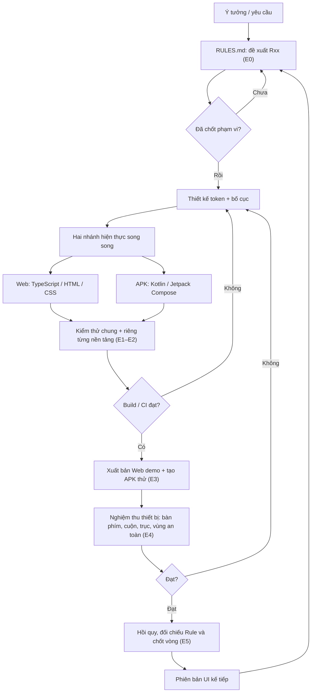
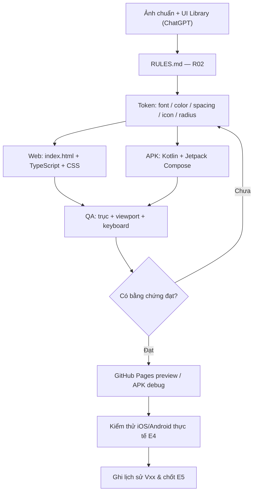

# 2027 — RULES.md

> **Nguồn quy tắc duy nhất (Single Source of Truth)**  
> Repo: `1sl2tp/2027` · Trạng thái: **R02 / UI-V01 — đang dựng khung** · Ngày: **18/11/2026 (giờ Việt Nam)**  
> Phạm vi: Web App/PWA (TypeScript + HTML + CSS) và Android APK native (Kotlin + Jetpack Compose).

## RULE 01 — MỘT FILE RULE DUY NHẤT

### 1. Mục tiêu
Toàn bộ các quyết định kiến trúc, UX/UI, CSS/design tokens, Android Compose, chất lượng, bảo mật, quy trình kiểm thử và phát hành của `2027` được quản lý **trong duy nhất file `/RULES.md`**.

### 2. Điều bắt buộc
1. **Chỉ `/RULES.md` được đặt ra quy tắc chuẩn tắc.** Không tạo `AGENTS.md`, `RULES-v2.md`, `STYLE_RULES.md`, `docs/*rules*` hoặc bản quy tắc song song có khả năng xung đột.
2. README, source code, tài liệu kỹ thuật và workflow CI **có thể trích dẫn hoặc triển khai** quy tắc này, nhưng **không tự bổ sung quy tắc khác**. Nếu thấy bất đồng, sửa `RULES.md` trước rồi đồng bộ code/test trong cùng thay đổi.
3. Mỗi thay đổi quy tắc phải ghi **mã phiên bản Rxx, mục đích, lý do, ảnh hưởng Web/APK, trường hợp kiểm thử, bằng chứng và cách hoàn tác** ngay trong file này.
4. Không gộp **đề xuất** với **đã triển khai**. Mỗi quyết định phải có trạng thái: `Đề xuất` → `Chấp nhận` → `Đang làm` → `Đã kiểm thử` → `Đã phát hành` → `Đã nghiệm thu thực tế`.
5. **Một hệ thiết kế, hai renderer:** Web dùng TypeScript/HTML/CSS; Android dùng Kotlin/Jetpack Compose. Không dùng WebView để giả làm APK native. Tỷ lệ, thứ bậc, token và hành vi phải đối chiếu được, nhưng tôn trọng API native từng hệ.
6. Mọi thay đổi phải **không làm gián đoạn dữ liệu thật**, không lấy token, khóa API, tin nhắn, đơn hàng, thông tin khách hàng hoặc CSDL production từ dự án khác. Chưa cấu hình backend thì UI chỉ là khung, không được giả vờ gửi/thu thành công.
7. **Không mặc định deploy production**, sửa DB production, gửi thông báo/tin nhắn hay giao dịch thật. Phát hành demo và xây APK thử là những bước riêng, cần có kết quả build và kiểm tra thực tế.

### 3. Cách kiểm soát mỗi vòng
Định danh: `2027-R01`, `2027-R02`, ... (quy tắc) và `2027-UI-V01`, `2027-UI-V02`, ... (vòng thiết kế). **Rxx không phải số phiên bản ứng dụng đã phát hành.**

Các chứng cứ:
- **E0** — yêu cầu, quy tắc và phạm vi được ghi rõ.
- **E1** — code và kiểm thử tĩnh đã có.
- **E2** — kiểm thử tự động/build cục bộ đạt.
- **E3** — CI, bản build hoặc deploy demo có xác nhận thành công.
- **E4** — mở và thao tác trên Web/PWA và APK thiết bị thật; ghi bằng chứng từng nền tảng.
- **E5** — nghiệm thu, hồi quy và xác nhận không có tác động ngoài phạm vi.

Không ghi `PASS` cho E2–E5 khi chưa có bằng chứng. Link GitHub source không đồng nghĩa demo đã xuất bản.

### 4. Sơ đồ tiến trình thống nhất



### 5. Sơ đồ cấu trúc dự kiến (chưa khẳng định đã tạo)
```text
2027/
├── RULES.md             ← tài liệu quy tắc duy nhất (đã tạo ở R01)
├── web/                 ← TypeScript + HTML + CSS (dự kiến)
├── android/             ← Kotlin + Jetpack Compose (dự kiến)
└── .github/workflows/   ← kiểm thử và build (dự kiến)
```

### 6. Tiêu chí hoàn thành RULE 01
- [x] Tồn tại một file `RULES.md` tại gốc repo.
- [x] Định nghĩa rõ một nguồn quy tắc, phạm vi Web/APK, cách đặt phiên bản và chuẩn E0–E5.
- [x] Sơ đồ luồng công việc được ghi trực tiếp trong `RULES.md`.
- [ ] Có kiểm tra tự động bảo đảm không thêm file quy tắc thứ hai (thuộc vòng triển khai tiếp theo).
- [ ] Có Web demo và APK chạy được (thuộc các vòng triển khai tiếp theo).

### 7. Nhật ký thay đổi

| Mã | Ngày VN | Nội dung | Trạng thái |
|---|---|---|---|
| 2027-R01 | 18/11/2026 | Khởi tạo một nguồn rule duy nhất, quy ước Web/APK, vòng sửa, E0–E5 và sơ đồ tiến trình | Đã có commit, E0–E1 |

### 8. Rollback
Nếu R01 cần sửa, **không tạo file quy tắc thay thế**. Chỉnh cùng `RULES.md`, tăng mã Rxx và ghi nguyên nhân. Nếu phải hoàn tác, dùng lịch sử commit GitHub, giữ đúng một rule owner.

---

## RULE 02 — CHAT DESIGN SYSTEM V01 (Web + Android native)

**Mã**: `2027-R02` · **Phiên bản khung**: `2027-UI-V01` · **Ngày VN**: 18/11/2026  
**Trạng thái**: E0 (đặc tả) + E1 (khung source) được tạo; E2/E3/E4/E5 chỉ ghi đạt khi có bằng chứng build/CI, bản xem thử và kiểm thử thiết bị tương ứng.

### 2.1. Nguyên tắc sản phẩm
- Đích tham khảo là **mức độ hoàn thiện thị giác và hành vi của ChatGPT**: chữ, font, màu, lề, khoảng cách, độ bo, icon, kích thước điều khiển, scroll và composer. Yêu cầu "giống 100%" được diễn giải thành **mục tiêu so sánh pixel từng vùng với ảnh tham chiếu đã chốt**, không được khẳng định "100%" khi chưa có đo thực tế, và không sao chép logo/tên/nhãn thương mại hoặc giả danh ChatGPT.
- Học **ChatGPT (phân cấp nội dung, composer, vùng đọc)**, **WhatsApp (điều hướng hội thoại, media)**, **Telegram (phản hồi nhanh, điều hướng)**, **Signal (tối giản, trạng thái riêng tư)**, **iMessage (native touch/keyboard)**. Các hãng khác là *tham khảo quy luật*, không tự động hợp nhất những hành vi mâu thuẫn.
- Giữ nhận diện tên app **2027**. Không hiển thị giả tin nhắn/khách hàng/đơn hàng; khi chưa kết nối phải ghi rõ trạng thái, không tạo nút gửi thành công giả.
- **Một thiết kế, hai triển khai**: Web = TypeScript/HTML/CSS; APK = Kotlin/Jetpack Compose. Token semantic dùng chung; Compose dùng dp/sp và thích nghi mật độ thiết bị, không nhúng HTML/CSS trong APK.

### 2.2. Token thị giác cơ sở, áp dụng cho cả 2 nền tảng

| Token | Light | Dark | Dùng cho |
|---|---|---|---|
| `bg` | `#FFFFFF` | `#161616` | Mặt nền hội thoại |
| `sidebar` | `#F9F9F9` | `#171717` | Sidebar / drawer |
| `surface` | `#F7F7F8` | `#292929` | Thẻ nền nhẹ |
| `soft` | `#F1F1F1` | `#2E2E2E` | Tab được chọn |
| `ink` | `#171717` | `#F3F3F3` | Chữ chính |
| `muted` | `#656565` | `#B2B2B2` | Chữ phụ |
| `line` | đen ~9.5% alpha | trắng ~11% alpha | Viền mảnh |
| `focus` | `#3A83F7` | `#3A83F7` | Focus rõ ràng |

- Font Web: `-apple-system-body, ui-sans-serif, -apple-system, BlinkMacSystemFont, Segoe UI, Arial, sans-serif`. Font APK: `FontFamily.SansSerif` tôn trọng Android font rendering. Không đóng gói font độc quyền hoặc nạp font từ CDN.
- Typography: input/nội dung chính **16px/24px** (Compose 16sp/24sp); header title **18/26**; tên tab **13–14/20**; chú thích **12–14/20–22**; version **10–11px**; primary weight 600–650, secondary 400–500.
- Nhịp spacing một nguồn: **4, 8, 12, 16, 20, 24, 32px** (Compose dp tương ứng). Không dùng margin tùy tiện làm lệch 2 cạnh.
- Icon nét giản lược khoảng **20px, stroke 1.8**, nhưng vùng tương tác độc lập **44 × 44px/dp**; icon không được nhỏ/lệch vì padding của button. Label dài không che icon.
- Radius: composer **28px/dp**, tabs tròn capsule, panel **12–18px**. Border mặc định 1px/1dp, shadow rất nhẹ hoặc không có.
- Header cao **56px/dp**; sidebar desktop **260px**; cột đọc/chứa composer tối đa **720px**; composer tối thiểu **56px/dp**; ô nhập tự giãn tối đa **160px**, sau đó cuộn bên trong.
- Các giá trị này là **baseline theo bản chụp tham chiếu lưu trên Drive**, không phải tuyên bố thông số ChatGPT hiện hành bất biến.

### 2.3. Trục bố cục, từ ngoài vào trong
- **M1 / Shell**: chiếm đúng phần màn hình có thể nhìn; không cuộn cả body; Web đo `window.visualViewport` (height + offsetTop) khi bàn phím mở.
- **M2 / Header**: chiều cao cố định 56; menu trái, tab trung tâm, tìm kiếm/chế độ nhìn phải. Các nút căn tâm thị giác và có hit target 44.
- **M3 / Nội dung hội thoại**: phần **flex:1, min-height:0**, tự cuộn một owner; cột nội dung 720 tối đa, căn giữa desktop; mobile dùng full width với gutter 12–18. Không đẩy composer xuống dưới màn hình khi keyboard hiện.
- **M4 / Composer**: đứng cuối vùng khả dụng và ở trên keyboard/safe-area; layout theo trục nút – text – mic – gửi. Khi text 1–6 dòng, ô nhập mở theo nội dung; sau đó scroll nội bộ. Không rung giật khi xuống dòng, dấu câu hoặc bàn phím gợi ý thay đổi.
- **P1–P4 / Popup**: overlay phải nằm trong visual viewport; focus không bị cắt; input/tác vụ đóng và danh sách kết quả được tiếp cận trên iOS Safari, Chrome Android, Web/PWA và APK native.
- **Responsiveness**: desktop sidebar hiện thường trực; màn hình <=760px sidebar thành drawer; <=350px điều chỉnh khoảng trống nhưng không để nội dung gây tràn ngang. Nút và glyph vẫn cân xứng.
- **Tính năng tối thiểu**: mở/đóng menu, chọn Trò chuyện/Công việc, tìm kiếm trạng thái rỗng, sáng/tối (Web) hoặc theo hệ điều hành (Android), nhập nháp, bật nút gửi khi có nội dung. Chưa nối backend → click gửi báo chưa tích hợp và giữ bản nháp.

### 2.4. Reference và phương pháp nghiệm thu
Nguồn ảnh/số đo được phép đối chiếu:
- UI Library đã cung cấp: `https://drive.google.com/drive/folders/1-lafp9tLlQC7uRAX3jSyhvb9kmWj_Jgq`; snapshot thư viện cho biết spacing 4px, nhóm font hệ thống, header 52–56px, composer bo 28px/min-height 56px, trục nội dung khoảng 720px.
- Ảnh tham chiếu iPhone/Web có thể khác phiên bản thực tế; cần chốt hình và kích cỡ viewport trước khi đánh giá sai số.

**Nghiệm thu bắt buộc**: 
1. So hai cột cạnh/cùng trục: header, văn bản, ô nhập, nút, nội dung, khoảng trống, khi 320/360/375/390/414/430px và desktop 1024/1440px.
2. Đo keyboard đóng/mở trên iPhone Safari/PWA, Android Chrome/PWA và APK Compose: phần thấy được, nút gửi không khuất, last row chạm được, không double scroll, không focus zoom iOS.
3. Thử 1/3/6/10 dòng, landscape, safe area, dark theme, reduced motion, menu/drawer, Back, accessibility focus, font scale lớn.
4. Kiểm tra tính nhất quán sau mỗi vòng bằng ảnh chụp, đo hình học, log và build; ghi E0–E5 riêng Web/APK.
5. Cần dữ liệu thật/API ở các vòng sau phải qua xác thực, phân quyền và test read-only trước; không dùng data production để lấp khung.

### 2.5. Sơ đồ xây khung



### 2.6. Hạng mục code V01
- `index.html`, `web/styles.css`, `web/src/app.ts`: shell Web, tab, drawer, composer co giãn, popup tìm kiếm, theme và no-send guard.
- `android/app/src/main/java/app/twentytwentyseven/chat/MainActivity.kt`: shell native cùng cấu trúc, có imePadding/navigationBarsPadding, draft nhập được, gửi chỉ báo trạng thái.
- `tests/layout.test.mjs`: hợp đồng cấu trúc Web/native và một file RULES duy nhất.
- `.github/workflows/pages.yml`: dự định build/kiểm thử và phát hành Pages khi repo đã bật chế độ Pages dùng Actions.
- `.github/workflows/android.yml`: dự định assembleDebug và cung cấp APK debug qua workflow artifacts. Chưa coi APK tồn tại cho đến khi build SUCCESS.

**Nhật ký R02**
| Mã | Nội dung | Trạng thái |
|---|---|---|
| 2027-R02 / 2027-UI-V01 | Tạo khung Chat Web và khung Kotlin Compose, bộ token chung, keyboard-first, trạng thái rỗng không dữ liệu giả | E0 + E1; E2–E5 chờ bằng chứng |

**Hoàn tác**: revert commit R02, khôi phục toàn bộ Web/native/workflow cùng một lần. Giữ nguyên R01, không tạo file quy tắc thứ hai.

---

### 2.7. UI-V02 — Căn lại khung từ ảnh so sánh Web/iPhone (18/11/2026)

**Tình trạng**: đã tạo source và bổ sung kiểm thử cấu trúc; CI/Pages/thiết bị thật phải được xác nhận riêng.

- **Hình học**: header mobile phân 3 trục trái–giữa–phải; tab được giữ ở giữa, một hành động cạnh phải. Tìm kiếm và theme chuyển vào drawer trên màn hình hẹp; trên desktop các chức năng vẫn nằm ở header.
- **Nội dung rỗng**: không đặt tiêu đề và icon quảng bá chiếm vùng đọc; giữ đúng một dòng trạng thái nhỏ ở cuối vùng hội thoại. Không giả dữ liệu.
- **Composer hai tầng**: hàng 1 là textarea 16px/24px với auto-grow 36–144px; hàng 2 có nút thêm bên trái, mic và gửi bên phải. Control 44px (<=350px điều chỉnh 40px với phương án kiểm thử truy cập riêng); không dùng vị trí tuyệt đối gây chồng hàng.
- **Keyboard/Popup**: composer nằm cuối visual viewport, popup tìm kiếm bám đỉnh phần màn hình nhìn thấy; vẫn yêu cầu kiểm thử iOS Safari/Chrome PWA và Android thật.
- **Đánh giá so khớp**: ảnh từ thiết bị và trình duyệt chỉ dùng để xác định khác biệt. Không kết luận giống ChatGPT 100% khi chưa đo cùng viewport, font scaling, keyboard và độ phân giải.
- **Phạm vi**: V02 điều chỉnh Web; APK Compose vẫn ở V01 và được đánh dấu *chưa đồng bộ V02*, tránh tuyên bố sai.
- **Trở lui**: revert thay đổi V02 ở `index.html`, `web/styles.css`, `web/src/app.ts`, `tests/layout.test.mjs` và đoạn 2.7 tại đây; không ảnh hưởng dữ liệu/backend.

| Phiên bản | Thay đổi | Bằng chứng |
|---|---|---|
| `2027-UI-V02` | Header ba trục, empty state tối giản, composer hai tầng, popup đúng visual viewport | E0/E1; E2–E5 cần xác minh |

### 2.8. CI Android — sửa môi trường build sau V02 (18/11/2026)

Lần chạy GitHub Actions của nhánh APK thất bại ở `android-actions/setup-android@v3`, vì `sdkmanager tools` trả lỗi `Failed to find package 'tools'` trước khi Gradle được chạy. Chỉ thay thế bước chuẩn bị SDK bằng công cụ có sẵn trên runner và cài đúng `platforms;android-35`, `build-tools;35.0.0`; không sửa mã nghiệp vụ hay token. Chỉ đánh dấu APK debug có khi `assembleDebug` và upload artifact thành công. Rollback: hoàn tác riêng bước setup Android nếu có lỗi runner tương thích mới.
