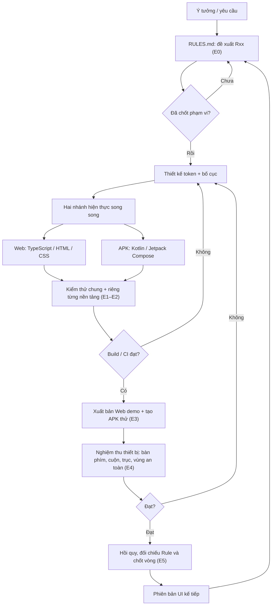
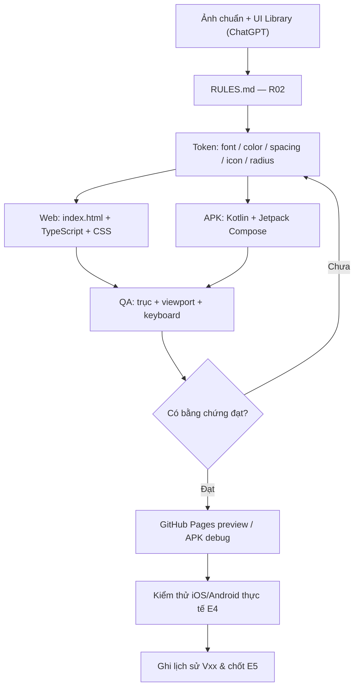

# 2027 — RULES.md

> **Nguồn quy tắc duy nhất (Single Source of Truth)**  
> Repo: `1sl2tp/2027` · Trạng thái: **R06 / UI-V12 — thư viện UI/UX** · Cập nhật: **22/11/2026 (giờ Việt Nam)**  
> Phạm vi: Web App/PWA (TypeScript + HTML + CSS) và Android APK native (Kotlin + Jetpack Compose).

## RULE 01 — MỘT FILE RULE DUY NHẤT

### 1. Mục tiêu
Toàn bộ các quyết định kiến trúc, UX/UI, CSS/design tokens, Android Compose, chất lượng, bảo mật, quy trình kiểm thử và phát hành của `2027` được quản lý **trong duy nhất file `/RULES.md`**.

### 2. Điều bắt buộc
1. **Chỉ `/RULES.md` được đặt ra quy tắc chuẩn tắc.** Không tạo `AGENTS.md`, `RULES-v2.md`, `STYLE_RULES.md`, `docs/*rules*` hoặc bản quy tắc song song có khả năng xung đột.
2. README, source code, tài liệu kỹ thuật và workflow CI **có thể trích dẫn hoặc triển khai** quy tắc này, nhưng **không tự bổ sung quy tắc khác**. Nếu thấy bất đồng, sửa `RULES.md` trước rồi đồng bộ code/test trong cùng thay đổi.
3. Mỗi thay đổi quy tắc phải ghi **mã phiên bản Rxx, mục đích, lý do, ảnh hưởng Web/APK, trường hợp kiểm thử, bằng chứng và cách hoàn tác** ngay trong file này.
4. Không gộp **đề xuất** với **đã triển khai**. Mỗi quyết định phải có trạng thái: `Đề xuất` → `Chấp nhận` → `Đang làm` → `Đã kiểm thử` → `Đã phát hành` → `Đã nghiệm thu thực tế`.
5. **Một hệ thiết kế, hai renderer:** Web dùng TypeScript/HTML/CSS; Android dùng Kotlin/Jetpack Compose. Không dùng WebView để giả làm APK native. Tỷ lệ, thứ bậc, token và hành vi phải đối chiếu được, nhưng tôn trọng API native từng hệ.
6. Mọi thay đổi phải **không làm gián đoạn dữ liệu thật**, không lấy token, khóa API, tin nhắn, đơn hàng, thông tin khách hàng hoặc CSDL production từ dự án khác. Chưa cấu hình backend thì UI chỉ là khung, không được giả vờ gửi/thu thành công.
7. **Không mặc định deploy production**, sửa DB production, gửi thông báo/tin nhắn hay giao dịch thật. Phát hành demo và xây APK thử là những bước riêng, cần có kết quả build và kiểm tra thực tế.

### 3. Cách kiểm soát mỗi vòng
Định danh: `2027-R01`, `2027-R02`, ... (quy tắc) và `2027-UI-V01`, `2027-UI-V02`, ... (vòng thiết kế). **Rxx không phải số phiên bản ứng dụng đã phát hành.**

Các chứng cứ:
- **E0** — yêu cầu, quy tắc và phạm vi được ghi rõ.
- **E1** — code và kiểm thử tĩnh đã có.
- **E2** — kiểm thử tự động/build cục bộ đạt.
- **E3** — CI, bản build hoặc deploy demo có xác nhận thành công.
- **E4** — mở và thao tác trên Web/PWA và APK thiết bị thật; ghi bằng chứng từng nền tảng.
- **E5** — nghiệm thu, hồi quy và xác nhận không có tác động ngoài phạm vi.

Không ghi `PASS` cho E2–E5 khi chưa có bằng chứng. Link GitHub source không đồng nghĩa demo đã xuất bản.

### 4. Sơ đồ tiến trình thống nhất



### 5. Sơ đồ cấu trúc dự kiến (chưa khẳng định đã tạo)
```text
2027/
├── RULES.md             ← tài liệu quy tắc duy nhất (đã tạo ở R01)
├── web/                 ← TypeScript + HTML + CSS (dự kiến)
├── android/             ← Kotlin + Jetpack Compose (dự kiến)
└── .github/workflows/   ← kiểm thử và build (dự kiến)
```

### 6. Tiêu chí hoàn thành RULE 01
- [x] Tồn tại một file `RULES.md` tại gốc repo.
- [x] Định nghĩa rõ một nguồn quy tắc, phạm vi Web/APK, cách đặt phiên bản và chuẩn E0–E5.
- [x] Sơ đồ luồng công việc được ghi trực tiếp trong `RULES.md`.
- [ ] Có kiểm tra tự động bảo đảm không thêm file quy tắc thứ hai (thuộc vòng triển khai tiếp theo).
- [ ] Có Web demo và APK chạy được (thuộc các vòng triển khai tiếp theo).

### 7. Nhật ký thay đổi

| Mã | Ngày VN | Nội dung | Trạng thái |
|---|---|---|---|
| 2027-R01 | 18/11/2026 | Khởi tạo một nguồn rule duy nhất, quy ước Web/APK, vòng sửa, E0–E5 và sơ đồ tiến trình | Đã có commit, E0–E1 |

### 8. Rollback
Nếu R01 cần sửa, **không tạo file quy tắc thay thế**. Chỉnh cùng `RULES.md`, tăng mã Rxx và ghi nguyên nhân. Nếu phải hoàn tác, dùng lịch sử commit GitHub, giữ đúng một rule owner.

---

## RULE 02 — CHAT DESIGN SYSTEM V01 (Web + Android native)

**Mã**: `2027-R02` · **Phiên bản khung**: `2027-UI-V01` · **Ngày VN**: 18/11/2026  
**Trạng thái**: E0 (đặc tả) + E1 (khung source) được tạo; E2/E3/E4/E5 chỉ ghi đạt khi có bằng chứng build/CI, bản xem thử và kiểm thử thiết bị tương ứng.

### 2.1. Nguyên tắc sản phẩm
- Đích tham khảo là **mức độ hoàn thiện thị giác và hành vi của ChatGPT**: chữ, font, màu, lề, khoảng cách, độ bo, icon, kích thước điều khiển, scroll và composer. Yêu cầu "giống 100%" được diễn giải thành **mục tiêu so sánh pixel từng vùng với ảnh tham chiếu đã chốt**, không được khẳng định "100%" khi chưa có đo thực tế, và không sao chép logo/tên/nhãn thương mại hoặc giả danh ChatGPT.
- Học **ChatGPT (phân cấp nội dung, composer, vùng đọc)**, **WhatsApp (điều hướng hội thoại, media)**, **Telegram (phản hồi nhanh, điều hướng)**, **Signal (tối giản, trạng thái riêng tư)**, **iMessage (native touch/keyboard)**. Các hãng khác là *tham khảo quy luật*, không tự động hợp nhất những hành vi mâu thuẫn.
- Giữ nhận diện tên app **2027**. Không hiển thị giả tin nhắn/khách hàng/đơn hàng; khi chưa kết nối phải ghi rõ trạng thái, không tạo nút gửi thành công giả.
- **Một thiết kế, hai triển khai**: Web = TypeScript/HTML/CSS; APK = Kotlin/Jetpack Compose. Token semantic dùng chung; Compose dùng dp/sp và thích nghi mật độ thiết bị, không nhúng HTML/CSS trong APK.

### 2.2. Token thị giác cơ sở, áp dụng cho cả 2 nền tảng

| Token | Light | Dark | Dùng cho |
|---|---|---|---|
| `bg` | `#FFFFFF` | `#161616` | Mặt nền hội thoại |
| `sidebar` | `#F9F9F9` | `#171717` | Sidebar / drawer |
| `surface` | `#F7F7F8` | `#292929` | Thẻ nền nhẹ |
| `soft` | `#F1F1F1` | `#2E2E2E` | Tab được chọn |
| `ink` | `#171717` | `#F3F3F3` | Chữ chính |
| `muted` | `#656565` | `#B2B2B2` | Chữ phụ |
| `line` | đen ~9.5% alpha | trắng ~11% alpha | Viền mảnh |
| `focus` | `#3A83F7` | `#3A83F7` | Focus rõ ràng |

- Font Web: `-apple-system-body, ui-sans-serif, -apple-system, BlinkMacSystemFont, Segoe UI, Arial, sans-serif`. Font APK: `FontFamily.SansSerif` tôn trọng Android font rendering. Không đóng gói font độc quyền hoặc nạp font từ CDN.
- Typography: input/nội dung chính **16px/24px** (Compose 16sp/24sp); header title **18/26**; tên tab **13–14/20**; chú thích **12–14/20–22**; version **10–11px**; primary weight 600–650, secondary 400–500.
- Nhịp spacing một nguồn: **4, 8, 12, 16, 20, 24, 32px** (Compose dp tương ứng). Không dùng margin tùy tiện làm lệch 2 cạnh.
- Icon nét giản lược khoảng **20px, stroke 1.8**, nhưng vùng tương tác độc lập **44 × 44px/dp**; icon không được nhỏ/lệch vì padding của button. Label dài không che icon.
- Radius: composer **28px/dp**, tabs tròn capsule, panel **12–18px**. Border mặc định 1px/1dp, shadow rất nhẹ hoặc không có.
- Header cao **56px/dp**; sidebar desktop **260px**; cột đọc/chứa composer tối đa **720px**; composer tối thiểu **56px/dp**; ô nhập tự giãn tối đa **160px**, sau đó cuộn bên trong.
- Các giá trị này là **baseline theo bản chụp tham chiếu lưu trên Drive**, không phải tuyên bố thông số ChatGPT hiện hành bất biến.

### 2.3. Trục bố cục, từ ngoài vào trong
- **M1 / Shell**: chiếm đúng phần màn hình có thể nhìn; không cuộn cả body; Web đo `window.visualViewport` (height + offsetTop) khi bàn phím mở.
- **M2 / Header**: chiều cao cố định 56; menu trái, tab trung tâm, tìm kiếm/chế độ nhìn phải. Các nút căn tâm thị giác và có hit target 44.
- **M3 / Nội dung hội thoại**: phần **flex:1, min-height:0**, tự cuộn một owner; cột nội dung 720 tối đa, căn giữa desktop; mobile dùng full width với gutter 12–18. Không đẩy composer xuống dưới màn hình khi keyboard hiện.
- **M4 / Composer**: đứng cuối vùng khả dụng và ở trên keyboard/safe-area; layout theo trục nút – text – mic – gửi. Khi text 1–6 dòng, ô nhập mở theo nội dung; sau đó scroll nội bộ. Không rung giật khi xuống dòng, dấu câu hoặc bàn phím gợi ý thay đổi.
- **P1–P4 / Popup**: overlay phải nằm trong visual viewport; focus không bị cắt; input/tác vụ đóng và danh sách kết quả được tiếp cận trên iOS Safari, Chrome Android, Web/PWA và APK native.
- **Responsiveness**: desktop sidebar hiện thường trực; màn hình <=760px sidebar thành drawer; <=350px điều chỉnh khoảng trống nhưng không để nội dung gây tràn ngang. Nút và glyph vẫn cân xứng.
- **Tính năng tối thiểu**: mở/đóng menu, chọn Trò chuyện/Công việc, tìm kiếm trạng thái rỗng, sáng/tối (Web) hoặc theo hệ điều hành (Android), nhập nháp, bật nút gửi khi có nội dung. Chưa nối backend → click gửi báo chưa tích hợp và giữ bản nháp.

### 2.4. Reference và phương pháp nghiệm thu
Nguồn ảnh/số đo được phép đối chiếu:
- UI Library đã cung cấp: `https://drive.google.com/drive/folders/1-lafp9tLlQC7uRAX3jSyhvb9kmWj_Jgq`; snapshot thư viện cho biết spacing 4px, nhóm font hệ thống, header 52–56px, composer bo 28px/min-height 56px, trục nội dung khoảng 720px.
- Ảnh tham chiếu iPhone/Web có thể khác phiên bản thực tế; cần chốt hình và kích cỡ viewport trước khi đánh giá sai số.

**Nghiệm thu bắt buộc**: 
1. So hai cột cạnh/cùng trục: header, văn bản, ô nhập, nút, nội dung, khoảng trống, khi 320/360/375/390/414/430px và desktop 1024/1440px.
2. Đo keyboard đóng/mở trên iPhone Safari/PWA, Android Chrome/PWA và APK Compose: phần thấy được, nút gửi không khuất, last row chạm được, không double scroll, không focus zoom iOS.
3. Thử 1/3/6/10 dòng, landscape, safe area, dark theme, reduced motion, menu/drawer, Back, accessibility focus, font scale lớn.
4. Kiểm tra tính nhất quán sau mỗi vòng bằng ảnh chụp, đo hình học, log và build; ghi E0–E5 riêng Web/APK.
5. Cần dữ liệu thật/API ở các vòng sau phải qua xác thực, phân quyền và test read-only trước; không dùng data production để lấp khung.

### 2.5. Sơ đồ xây khung



### 2.6. Hạng mục code V01
- `index.html`, `web/styles.css`, `web/src/app.ts`: shell Web, tab, drawer, composer co giãn, popup tìm kiếm, theme và no-send guard.
- `android/app/src/main/java/app/twentytwentyseven/chat/MainActivity.kt`: shell native cùng cấu trúc, có imePadding/navigationBarsPadding, draft nhập được, gửi chỉ báo trạng thái.
- `tests/layout.test.mjs`: hợp đồng cấu trúc Web/native và một file RULES duy nhất.
- `.github/workflows/pages.yml`: dự định build/kiểm thử và phát hành Pages khi repo đã bật chế độ Pages dùng Actions.
- `.github/workflows/android.yml`: dự định assembleDebug và cung cấp APK debug qua workflow artifacts. Chưa coi APK tồn tại cho đến khi build SUCCESS.

**Nhật ký R02**
| Mã | Nội dung | Trạng thái |
|---|---|---|
| 2027-R02 / 2027-UI-V01 | Tạo khung Chat Web và khung Kotlin Compose, bộ token chung, keyboard-first, trạng thái rỗng không dữ liệu giả | E0 + E1; E2–E5 chờ bằng chứng |

**Hoàn tác**: revert commit R02, khôi phục toàn bộ Web/native/workflow cùng một lần. Giữ nguyên R01, không tạo file quy tắc thứ hai.

---

### 2.7. UI-V02 — Căn lại khung từ ảnh so sánh Web/iPhone (18/11/2026)

**Tình trạng**: đã tạo source và bổ sung kiểm thử cấu trúc; CI/Pages/thiết bị thật phải được xác nhận riêng.

- **Hình học**: header mobile phân 3 trục trái–giữa–phải; tab được giữ ở giữa, một hành động cạnh phải. Tìm kiếm và theme chuyển vào drawer trên màn hình hẹp; trên desktop các chức năng vẫn nằm ở header.
- **Nội dung rỗng**: không đặt tiêu đề và icon quảng bá chiếm vùng đọc; giữ đúng một dòng trạng thái nhỏ ở cuối vùng hội thoại. Không giả dữ liệu.
- **Composer hai tầng**: hàng 1 là textarea 16px/24px với auto-grow 36–144px; hàng 2 có nút thêm bên trái, mic và gửi bên phải. Control 44px (<=350px điều chỉnh 40px với phương án kiểm thử truy cập riêng); không dùng vị trí tuyệt đối gây chồng hàng.
- **Keyboard/Popup**: composer nằm cuối visual viewport, popup tìm kiếm bám đỉnh phần màn hình nhìn thấy; vẫn yêu cầu kiểm thử iOS Safari/Chrome PWA và Android thật.
- **Đánh giá so khớp**: ảnh từ thiết bị và trình duyệt chỉ dùng để xác định khác biệt. Không kết luận giống ChatGPT 100% khi chưa đo cùng viewport, font scaling, keyboard và độ phân giải.
- **Phạm vi**: V02 điều chỉnh Web; APK Compose vẫn ở V01 và được đánh dấu *chưa đồng bộ V02*, tránh tuyên bố sai.
- **Trở lui**: revert thay đổi V02 ở `index.html`, `web/styles.css`, `web/src/app.ts`, `tests/layout.test.mjs` và đoạn 2.7 tại đây; không ảnh hưởng dữ liệu/backend.

| Phiên bản | Thay đổi | Bằng chứng |
|---|---|---|
| `2027-UI-V02` | Header ba trục, empty state tối giản, composer hai tầng, popup đúng visual viewport | E0/E1; E2–E5 cần xác minh |

### 2.8. CI Android — sửa môi trường build sau V02 (18/11/2026)

Lần chạy GitHub Actions của nhánh APK thất bại ở `android-actions/setup-android@v3`, vì `sdkmanager tools` trả lỗi `Failed to find package 'tools'` trước khi Gradle được chạy. Chỉ thay thế bước chuẩn bị SDK bằng công cụ có sẵn trên runner và cài đúng `platforms;android-35`, `build-tools;35.0.0`; không sửa mã nghiệp vụ hay token. Chỉ đánh dấu APK debug có khi `assembleDebug` và upload artifact thành công. Rollback: hoàn tác riêng bước setup Android nếu có lỗi runner tương thích mới.


---

## RULE 03 — NGUYÊN TẮC UX/UI CHO THƯ VIỆN MẪU 2027

**Mã:** `2027-R03` · **Ngày:** 22/11/2026 (giờ Việt Nam) · **Trạng thái:** Áp dụng cho thiết kế mẫu; việc đáp ứng từng tiêu chí ở Web/PWA/Android phải được kiểm tra riêng.

### 3.1. Phạm vi và cách sử dụng

- `2027` là **kho thư viện mẫu UI/UX**. Giai đoạn hiện tại ưu tiên các mẫu font, cỡ chữ, kiểu chữ, màu nền, thành phần và cấu trúc khung; **không phải** ứng dụng CHAT đã kết nối dữ liệu. Các đặc tả chat trong R02 là tham chiếu lịch sử, không ép mọi mẫu UI phải giống chat.
- Các ý tưởng của chuyên gia dưới đây là **nguyên tắc thiết kế**, không phải bộ kích thước pixel cố định hoặc lời chứng thực của họ dành cho dự án. Mỗi quy tắc có ví dụ áp dụng riêng cho 2027 và tiêu chí quan sát được.
- Khi có mâu thuẫn, ưu tiên theo thứ tự: **an toàn/khả năng tiếp cận → hoàn thành tác vụ → nội dung dễ đọc → bố cục và nhất quán → trang trí**. Không tối giản bằng cách che thao tác cần thiết; không tăng chi tiết chỉ để lấp chỗ trống.
- Chỉ cập nhật rule ở `RULES.md`; không tạo file rule song song. Việc sửa rule không tự động cấp phép sửa CHAT production, dữ liệu, gửi thông báo hoặc phát hành APK.

### 3.2. Nguồn tư tưởng đã đối chiếu

| Tác giả/nguồn | Ý chính có thể tham khảo | Nguồn gốc |
|---|---|---|
| **Jakob Nielsen** | 10 usability heuristics: trạng thái hệ thống, phù hợp ngôn ngữ thực tế, kiểm soát, nhất quán, ngăn lỗi, nhận biết thay vì nhớ, tối giản | [Nielsen Norman Group — 10 Usability Heuristics](https://www.nngroup.com/articles/ten-usability-heuristics/) |
| **Don Norman** | Discoverability, signifiers, phản hồi, mô hình tư duy, quan hệ tự nhiên giữa điều khiển và kết quả | [Don Norman — Opportunities and Challenges for Touch](https://jnd.org/opportunities-and-challenges-for-touch-and-gesture-based-systems/) · [Design of Everyday Things](https://jnd.org/preface-design-of-everyday-things-revised-edition/) |
| **Steve Krug** | `Don't Make Me Think`: điều hướng dễ hiểu, giảm các câu hỏi không cần thiết cho người dùng | [Tác giả và sách](https://sensible.com/dont-make-me-think/) |
| **Luke Wroblewski** | Mobile first: giới hạn màn hình buộc ưu tiên tính năng, nội dung và thao tác quan trọng | [Mobile First — Constraints](https://www.lukew.com/mobilefirst/04-chapter-2/index.html) |
| **Brad Frost** | Atomic Design: atoms, molecules, organisms, templates, pages; nhìn thành phần và toàn thể cùng lúc, **không phải** quy trình tuyến tính bắt buộc | [Atomic Design — Methodology](https://atomicdesign.bradfrost.com/chapter-2/) |
| **Chuẩn bổ trợ, không phải tác giả nói trên** | WCAG 2.2: tương phản, mục tiêu tương tác; Apple HIG: vùng chạm và chữ có khả năng thích ứng | [W3C WCAG 2.2](https://www.w3.org/TR/WCAG22/) · [Apple HIG Accessibility](https://developer.apple.com/design/human-interface-guidelines/accessibility) |

### 3.3. Các quy tắc thực hành, độc lập với phong cách thị giác

| Mã | Quy tắc ứng dụng trong 2027 | Cách kiểm tra trong thư viện | Cơ sở |
|---|---|---|---|
| **UX-01 — Mục tiêu rõ** | Mỗi trang/mẫu phải có mục đích chính, một thứ bậc tiêu đề rõ, hành động chính dễ tìm; thành phần phụ không cạnh tranh sự chú ý. | Nhìn vào mẫu thấy nội dung ưu tiên và thao tác chính mà không cần đọc hướng dẫn dài. | Krug; Nielsen |
| **UX-02 — Trạng thái hiển thị** | Tùy chọn font, palette, cỡ chữ, nút, tab phải phân biệt trạng thái đang chọn/không chọn; thao tác có phản hồi thật, không báo thành công giả. | Đổi một lựa chọn, cả điều khiển và preview cập nhật đồng bộ; screen reader nhận `aria-pressed` hoặc trạng thái phù hợp. | Nielsen; Norman |
| **UX-03 — Ý nghĩa trước biểu tượng** | Label hành động dùng từ ngữ người dùng hiểu; icon chỉ bổ trợ. Signifier (dấu hiệu trực quan) phải gợi đúng nơi và cách tương tác. | Không cần đoán nút chỉ có biểu tượng lạ; thao tác và kết quả thống nhất. | Norman; Krug |
| **UX-04 — Nhất quán toàn thư viện** | Cùng chức năng dùng cùng tên, trục căn, token và hành vi ở các mẫu; không tạo nhiều kiểu nút trông giống nhau nhưng có tác dụng khác. | Đặt hai mẫu cạnh nhau, cùng loại thành phần có cùng vai trò và quy tắc. | Nielsen; Frost |
| **UX-05 — Tránh lỗi, có lối quay lại** | Hành động không hợp lệ được ngăn từ đầu; thay đổi thử nghiệm có thể `Đặt lại` hoặc hoàn tác. Thao tác nguy hiểm phải có biện pháp bảo vệ phù hợp. | Thử nhập/sửa/đặt lại; dữ liệu trong preview không bị mất ngoài dự kiến. | Nielsen |
| **UX-06 — Nhận biết thay vì ghi nhớ** | Các lựa chọn quan trọng, tên nhóm và lựa chọn hiện tại nhìn thấy được; menu phụ chỉ chứa chức năng ít dùng. | Chuyển nhóm mẫu rồi quay lại vẫn biết đang chọn gì, không phải nhớ bước trước. | Nielsen |
| **UX-07 — Tối giản có chủ đích** | Chỉ giữ thành phần cần cho mục đích của mẫu; khoảng trắng tạo nhóm và nhịp đọc, không tạo vùng rỗng hoặc thanh điều hướng vô ích. | Xóa một thành phần: nếu không giảm khả năng hiểu/thao tác thì có thể bỏ; nếu giảm thì giữ. | Krug; Nielsen |
| **UX-08 — Mobile first thật** | Thiết kế ở màn hình hẹp và trạng thái bàn phím mở trước, rồi mới mở rộng ra tablet/desktop; hành động thiết yếu luôn tiếp cận được. | So sánh 320/360/390/430px; bật bàn phím, thử ô nhập dài, safe area, xoay ngang; không che nút chính. | Wroblewski + yêu cầu riêng 2027 |
| **UX-09 — Thành phần có cấp** | Phân biệt token/atom (màu, font, nút), molecule (ô tìm + nút), organism (header/composer), template (khung), page (mẫu với nội dung). Thiết kế và kiểm tra hai chiều: phần ↔ toàn thể. | Sửa token trong một nguồn, các mẫu liên quan thay đổi nhất quán; không nhân bản bản vá CSS cho mỗi trang. | Frost |
| **UX-10 — Chữ là hệ thống phân cấp** | Tiêu đề, nội dung, nhãn phụ khác nhau có chủ đích về cỡ, đậm, dòng và khoảng cách; hỗ trợ dấu tiếng Việt, xuống dòng và phóng to chữ. Không dùng chữ nhỏ làm giải pháp duy nhất để nhét đủ nội dung. | Thử 4 họ font của V03, độ đậm 400–700, cỡ chữ 13–21px; ở mọi cỡ mẫu phải không chồng/tràn/cắt chữ. | Krug; Apple typography + lựa chọn dự án |
| **UX-11 — Tương phản đo được** | Với chữ thông thường, mục tiêu **WCAG 2.2 AA ≥ 4.5:1**; với chữ lớn đủ điều kiện, **≥ 3:1**. Không dùng màu sắc làm tín hiệu duy nhất. Palette chỉ là phương án thử đến khi đo và xác nhận độ tương phản cho đúng cặp chữ/nền. | Đo từng cặp chữ–nền của white/warm/mist/dark; đánh dấu `chưa đạt` nếu chưa đo, không ghi WCAG PASS theo cảm giác. | W3C WCAG 2.2 |
| **UX-12 — Vùng chạm và thao tác** | Với mẫu iPhone/iPad, ưu tiên vùng chạm **ít nhất 44×44 pt** theo Apple HIG. Với web, WCAG 2.2 AA dùng ngưỡng **24×24 CSS px hoặc ngoại lệ theo tiêu chí 2.5.8**; đây là hai hệ đo/khuyến nghị khác nhau, không được coi tương đương. Các nút chính trên mobile của dự án ưu tiên hit area khoảng **44 CSS px** khi có đủ diện tích. | Kiểm tra hit box thực tế, khoảng cách các đích, focus bàn phím và khả năng thao tác bằng một tay; icon nhỏ vẫn có vùng chạm đủ lớn. | Apple HIG; W3C WCAG 2.2 + lựa chọn dự án |
| **UX-13 — Không chồng quyền quản lý vùng** | Shell, Top 1, Top 2, Nội dung, vùng thao tác và overlay phải rõ cha–con; một vùng cuộn chính cho một bề mặt. Top 2 có thể ẩn khi không cần, composer giữ trong vùng nhìn thấy khi bàn phím mở. | Thử nội dung ngắn/dài, mobile/desktop, bàn phím đóng/mở; không double scroll, rung gõ hoặc nội dung bị che. | Áp dụng riêng 2027 từ mobile-first và discoverability |
| **UX-14 — Mẫu thật về hành vi, trung thực về dữ liệu** | UI Library dùng dữ liệu minh họa/khung trung tính; không giả trạng thái đã gửi, đã lưu máy chủ hay đã thu tiền. Bộ chọn, reset, preview, copy CSS phải hoạt động được hoặc được ghi rõ chưa hỗ trợ. | Từng nút có kết quả đúng nhãn; không network đến backend CHAT/TAPHOA và không dùng dữ liệu khách thật. | Nielsen + giới hạn bảo vệ của dự án |

### 3.4. Quy trình áp dụng khi tạo một mẫu mới

1. **Xác định tác vụ**: người dùng cần xem gì, làm gì, trên thiết bị nào; không bắt đầu bằng màu trước khi biết cấu trúc.
2. **Dựng khung cha–con**: Shell → Top 1/Top 2 → Nội dung → Thao tác/overlay; xác định vùng được phép co, cuộn, ẩn.
3. **Chọn token**: font, các cấp cỡ chữ, spacing, palette, radius; ưu tiên dùng biến có sẵn, không nhân bản.
4. **Tạo trạng thái đối chiếu**: bình thường/đang chọn/focus/disabled; sáng/tối; mobile/rộng; bàn phím đóng/mở nếu có input.
5. **Kiểm tra bằng chứng**: tương phản, nhãn, vùng chạm, keyboard, overflow, focus, khả năng quay lại; lưu phiên bản mẫu để so sánh trước/sau.
6. **Mới tinh chỉnh thẩm mỹ**: chỉnh lề, nhịp chữ, viền, độ bo, độ sâu, màu. Không tuyên bố giống 100% một ứng dụng khác khi chưa đo cùng viewport.

### 3.5. Bài kiểm tra đầu tiên — trang Chữ & màu nền V03

- Chọn một trong 4 palette → chỉ vùng preview đổi màu; toàn bộ nhãn và điều khiển thư viện vẫn nhận diện rõ.
- Chọn System UI/Arial/Georgia/Mono → tiếng Việt còn dấu đúng, không vỡ chữ; thử nội dung dài.
- Thay cỡ 13–21px, giãn dòng 1.20–1.90 và đậm 400/500/600/700 → thay đổi hiện ngay, không tràn khung mobile.
- Bản rộng và mobile có cùng nội dung/ý nghĩa; không ép chữ nhỏ vì màn hình hẹp.
- `Đặt lại` khôi phục lựa chọn mặc định; `Sao chép CSS` sao chép đúng token hiện hành hoặc báo rõ nếu không được cấp quyền.
- **Chưa xác nhận** WCAG/thiết bị thật nếu chưa đo; kiểm thử tĩnh/CI không thay cho E4/E5.

### 3.6. Thứ tự ưu tiên, lịch sử và hoàn tác

| Mã | Nội dung | Trạng thái |
|---|---|---|
| **2027-R03** | Tổng hợp Nielsen, Norman, Krug, Wroblewski, Frost; cụ thể hóa thành UX-01 đến UX-14 cho kho UI | Đã ghi đặc tả; chỉ ghi E2/E3 sau khi CI thực tế đạt; chưa nghiệm thu thiết bị E4/E5 |

**Ảnh hưởng:** Chỉ tài liệu chuẩn tắc của repo `2027` và kiểm thử hợp đồng tương ứng. Không thay giao diện CHAT production, không sửa backend, không thay Android APK. **Hoàn tác:** revert commit tài liệu R03; không tạo file quy tắc mới.

---

## RULE 04 — ĐỐI CHIẾU CÁC HỆ UI LỚN, NHƯNG GIỮ MỘT HỆ CSS RIÊNG

**Mã:** 2027-R04 · **Ngày:** 22/11/2026 (VN) · **Trạng thái:** Đã ghi đặc tả, chưa áp lại giao diện hoặc nghiệm thu thiết bị thật.

### 4.1. Mục đích và cơ sở

Dùng các bản lưu nguồn **ChatGPT, Facebook, Gemini** do người dùng đặt trong [thư mục UI 2027](https://drive.google.com/drive/folders/1uPNFbeA_lbJjIEZW0O__g4lTWWXJEVSj?hl=vi) làm đối chứng khi chọn thành phần UI. Bảng đối chiếu có bằng chứng CSS và giới hạn nguồn tại [`references/CHATGPT_FACEBOOK_GEMINI_UI_COMPARISON_2026-11-22.md`](./references/CHATGPT_FACEBOOK_GEMINI_UI_COMPARISON_2026-11-22.md).

- **ChatGPT:** lấy nguyên tắc typography, cột nội dung, Markdown, input/composer gọn, các trạng thái icon.
- **Facebook:** lấy nguyên tắc danh sách, sidebar, nhãn trạng thái, mật độ hàng, icon + chữ + vùng bên phải, bubble và input (chỉ từ component có bằng chứng).
- **Gemini:** lấy nguyên tắc nhịp spacing, bố cục co giãn, input đa chế độ, trạng thái viền/surface và menu.
- **2027:** chỉ dùng **một `web/styles.css`** và bộ token riêng; không tạo các theme/hệ CSS cạnh tranh theo hãng, không copy nguyên stylesheet/class build/asset proprietary.

### 4.2. Quy tắc bắt buộc

| Mã | Quy tắc | Điều kiện kiểm tra |
|---|---|---|
| UI-REF-01 | Phân biệt **nguồn HTML/CSS đã lưu**, **quan sát từ ảnh** và **quyết định thiết kế 2027**. | Mỗi con số ghi đúng nguồn và giới hạn snapshot; không khẳng định là CSS ChatGPT/Facebook/Gemini hiện tại khi chưa kiểm chứng. |
| UI-REF-02 | Mỗi thông số phải có **vai trò** trước khi có CSS; dùng token `font/color/spacing/radius/border/focus/hit-area` chung. | Thành phần bảng, nút, input số lượng, search, chat, menu và popup không sở hữu CSS nền tảng thứ hai. |
| UI-REF-03 | Nhìn **cấu trúc cha–con và trạng thái tương tác** trước khi tinh chỉnh màu hoặc bo góc. | So sánh desktop/mobile, input được focus, bàn phím mở, nội dung 1–4 dòng, số tiền, menu/popover. |
| UI-REF-04 | Không mang nội dung tài khoản, tên người, dữ liệu nhạy cảm, font file, hình thương hiệu hoặc đoạn CSS minified của bản Save Page vào repo demo. | Source Google Drive giữ nguyên, commit chỉ chứa mô tả, số liệu, các phần code do dự án tạo. |
| UI-REF-05 | Tách **giá trị xác nhận trong CSS** khỏi **lựa chọn áp dụng**. | Không áp/đổi CSS hoặc tự gắn trạng thái hoàn tất kiểm thử thiết bị chỉ dựa vào một ảnh hay biến CSS. |

### 4.3. Tác động, kiểm thử và hoàn tác

**Tác động Web/APK:** vòng R04 chỉ ghi tài liệu cho kho Web UI 2027, chưa áp cho `web/styles.css`/APK hoặc dự án CHAT/TAPHOA. Khi triển khai component trong các vòng sau, dùng các nguyên tắc UX-09–UX-14 và kiểm thử tương phản, focus, hit area, cuộn/chồng bàn phím, dark/mobile.

**Bằng chứng:** tài liệu đối chiếu trích các giá trị trong ba tệp HTML Save Page, liệt kê giới hạn trang Facebook Reel, preset ChatGPT Codex và các CSS theme/viewport Gemini; kiểm thử hợp đồng bảo đảm R04 và tài liệu không bị rơi khỏi repo. **Chưa có:** E4/E5 nghiệm thu trên thiết bị thực.

**Hoàn tác:** revert commit R04 (tài liệu + kiểm thử hợp đồng), không có schema/backend/CSS/app data cần đảo ngược.

---

## RULE 05 — GIỮ MỐC GỐC VÀ TÁI SỬ DỤNG MỘT MẪU NỀN TẢNG

**Mã:** 2027-R05 · **Ngày:** 22/11/2026 (VN) · **Trạng thái:** Đã ghi và có triển khai mẫu V09; chỉ đánh dấu đã kiểm thử/phát hành sau khi CI xác nhận, chưa nghiệm thu thiết bị thật.

### 5.1. Mục đích và lý do

Giữ nguyên bản thư viện hiện có trước khi tạo mẫu mới, đồng thời xây **một mẫu gốc 2027** độc lập có thể so sánh các hướng giao diện từ **ChatGPT, Facebook và Gemini** theo RULE 04. Tránh mất bản đã duyệt hoặc sửa chắp vá theo từng hãng.

### 5.2. Quy tắc chuẩn tắc

1. **Mốc bảo tồn:** commit `7e10663b72e85c63621462048a262897f36c3182` là V08 nguyên trạng; nhánh `archive/ui-v08-original-before-foundation-20261122` chỉ làm nhãn tham chiếu. Không ghi đè hoặc dùng làm nơi phát triển; commit SHA là mốc bất biến.
2. **Tệp nguồn hãng:** giữ ba bản Save Page trong [Drive UI 2027](https://drive.google.com/drive/folders/1uPNFbeA_lbJjIEZW0O__g4lTWWXJEVSj?hl=vi) nguyên trạng; danh mục và giới hạn nguồn ở `references/ORIGINAL_UI_SOURCES_AND_BASELINE_2026-11-22.md`. Không đưa toàn bộ HTML/CSS minified hoặc nội dung tài khoản đã lưu vào repo.
3. **Mẫu gốc duy nhất:** `base.html` là bề mặt thử các mẫu gốc; `web/src/base.ts` chỉ điều khiển state demo; **`web/styles.css` vẫn là tệp CSS duy nhất**. Không thêm stylesheet riêng theo tên hãng hay theo mô-đun.
4. **Bốn hướng, một DOM:** `original` là kiểu nền tảng chuẩn của 2027. `chatgpt`, `facebook`, `gemini` là các **preset token tham khảo** cùng một bố cục để đo khác biệt, không khẳng định giống 100% hoặc là thiết kế chính thức.
5. **Cấu trúc xuyên mô-đun:** rail/sidebar/header/main/composer/overlay, typography, bảng, hàng icon + chữ, nút, input và vùng số lượng chỉ dùng vai trò/token thống nhất. UI bàn phím, focus, tràn chữ, nút chạm và cuộn phải qua kiểm thử mobile/rộng.
6. **An toàn và trung thực:** nút gửi tin, nhập số, đổi khách, chọn module, popup và menu chỉ mô phỏng, không thực hiện giao dịch. Mọi thao tác thử phải tạo phản hồi rõ hoặc báo không hỗ trợ, không giả lập thành công trên hệ thống thật.

### 5.3. Kiểm thử và trạng thái

- Kiểm tra một tệp CSS trên cả `index.html`, `flows.html`, `base.html`; build `web/src/base.ts` cùng TS hiện có, đóng gói `base.html` trong Pages.
- Kiểm tra bốn lựa chọn preset, hai viewport, ba mô-đun, input focus, số lượng 0–99, menu và popup; không gọi mạng, không gửi chat/số tiền thật.
- **Đã thực hiện:** lưu snapshot branch và khai báo base. **Chưa được xác nhận nếu chưa có báo cáo CI:** build, deploy và nghiệm thu mobile Safari/Chrome.
- **Phạm vi Web:** thêm demo V09, không thay nội dung V08 hoặc logic V04; **APK:** chưa đổi. **Hoàn tác:** revert các commit V09 trên main, vẫn còn mốc gốc và nguồn Drive.

---

## RULE 06 — MẪU PHẢI CÓ DANH MỤC, NÚT VÀ ICON PHẢI DÙNG CHUNG

**Mã:** 2027-R06 · **Ngày:** 22/11/2026 (VN) · **Trạng thái:** Đã triển khai V12 tại thư viện Web; nghiệm thu trực quan thiết bị thật còn mở.

### 6.1. Mục tiêu và lý do

Khi bổ sung mẫu mới vào thư viện, **không được tạo nút, biểu tượng, kiểu viền hoặc cỡ chữ rời rạc theo từng màn**. Mọi mẫu phải được phân loại vào thư viện trước, dùng token và primitive chung; các thành phần lớn (composer/chat, bảng, hàng, popup) chỉ lắp ghép các primitive đã được duyệt.

### 6.2. Quy tắc bắt buộc

1. **Phân loại trước:** mọi mẫu bổ sung phải vào một nhóm có chức năng rõ trong thư viện: Chữ; Bảng; Số lượng; Ô nhập/Chat; Nút & biểu tượng; Hàng & bố cục; Menu/popup. Không gắn mẫu mới trôi nổi ở một trang khác.
2. **Nút là thành phần gốc:** `.ui-button` dùng chung, kết hợp `.ui-button--primary`, `--secondary`, `--text`, `--icon`, `--mode`, `--send`; chỉ `web/styles.css` sở hữu các kiểu này. Mẫu nút chủ nằm ở `index.html#sample-actions`.
3. **Icon là một nguồn gốc SVG:** mọi icon chung phải được khai báo trong `web/icons.svg`. Các màn dùng `<svg class="ui-icon"><use href="./web/icons.svg#ui-icon-..."></use></svg>`, không tạo từng ký tự Unicode “↑”, “⌄” hoặc icon riêng để thế chỗ nếu đã có symbol tương ứng.
4. **Token quyết định kích thước:** `--ui-control-hit`, `--ui-control-glyph`, `--ui-control-plus`, `--ui-control-mic`, `--ui-control-chevron`, `--ui-control-send-glyph`, `--ui-control-send-disc`, `--ui-control-label`, `--ui-control-gap`. Mặc định V12 lần lượt gồm hit **44px**, glyph **20px**, plus **22px**, mic **19px**, chevron **13px**, arrow **20px**, vòng tròn **36px**, chữ chế độ **14px**, gap **2px**. Đây là số liệu của 2027, không tuyên bố trích chính xác từ ChatGPT.
5. **Thành phần lắp ghép chỉ sắp xếp:** bốn mẫu ô chat trong `index.html#sample-inputs` dùng chung `.ui-button`, `.ui-icon`, sprite SVG; CSS `.composer-*` chỉ quản lý chiều cao ô nhập, preview và layout, không được tự thay đổi `width/height/font-size` của nút + / Cao / mic / gửi.
6. **Nhân rộng không sao chép:** khi cần một nút/icon mới, cập nhật nhóm Nút & biểu tượng và định nghĩa gốc trước; nơi dùng chỉ thêm class và tham chiếu icon. Nếu tác động đến các màn cũ `base.html` và `flows.html`, phải làm kiểm thử hồi quy riêng, không giả nhận đã đồng bộ mọi màn.
7. **Kiểm thử cấu trúc và trải nghiệm:** CI xác nhận cả thư viện nút, icon, 4 composer dùng chung class, tệp SVG được đóng gói và link sâu hai nhóm; kiểm tra bằng thiết bị thật về focus, khoảng cách, kích thước chạm, media và bàn phím trước khi coi E4/E5 hoàn tất.

**Tài liệu kiểm kê không phải tệp rule riêng:** [`references/UI_COMPONENT_CATALOG_2026-11-22.md`](./references/UI_COMPONENT_CATALOG_2026-11-22.md).

### 6.3. Phạm vi và hoàn tác

- **Web:** sửa `index.html` V12, `web/styles.css`, `web/icons.svg`, `web/src/app.ts`, `web/src/composer-gallery.ts` và đóng gói Pages; 4 composer vẫn mô phỏng, không tải lên hay gửi thật.
- **APK:** chưa đổi. **Ứng dụng CHAT/TAPHOA thật:** chưa đổi. **Nguồn trong Drive:** không đổi.
- **Hoàn tác:** revert commit V12 để quay về V11; nhánh lưu V08 nguyên trạng. Nếu thiếu icon khi đóng gói, sửa lại bước sao chép `web/icons.svg` trong workflow và kiểm thử.
